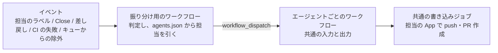
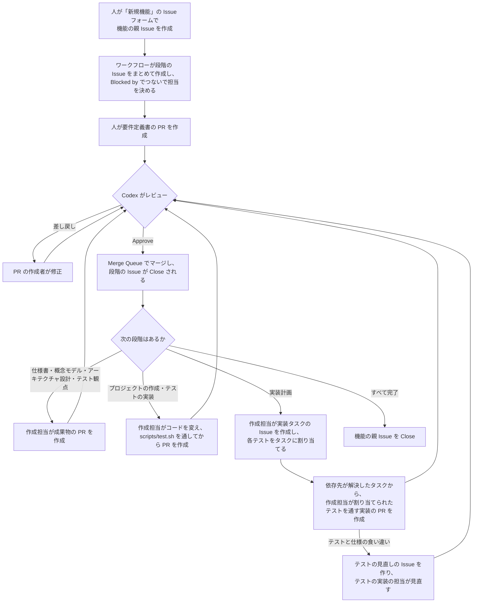

# Coding Agent による開発フローの仕様

この文書は、[README](../../README.md) の「開発フロー」に書かれた要件を、GitHub 上の仕組みとしてどう実現するかを定めた仕様です。

- 要件は README の擬似コードで、この文書はそれを実現する方法を表します
- 仕組みを作る順番と、今の進み具合は「[既存の実装からの移行と作る順番](#15-既存の実装からの移行と作る順番)」にまとめています

## 1. 前提

このリポジトリはテンプレートリポジトリで、仕組みが動くのは、テンプレートから作ったリポジトリ (以下「利用するリポジトリ」) である。

- 利用するリポジトリは、GitHub Organization が所有する public リポジトリとする
- 開発は Issue ドリブンで進める。どの作業も Issue から始まる
- 利用するリポジトリでは、`develop` を既定ブランチにする。エージェントが扱うのは `develop` までで、`main` へのマージは人が行う
  - `Closes #N` などのキーワードは、既定ブランチに向けた PR でしか働かない。PR と Issue を確実につなぐため、`develop` を既定ブランチにする

テンプレート自体は、次のように扱う。

- `main` を既定ブランチのまま、人が仕組みを開発する。`develop` は作らない
- テンプレート自体では仕組みを動かさない。Variables の `CODING_AGENT_ENABLED` が `true` でなければ、どのワークフローも何もせずに終わる (13 章)
- テンプレートから作ったときに引き継がれないもの (ブランチ、ルールセット、Variables、Secrets、ラベル) は、利用するリポジトリのセットアップで用意する (14 章)
- 動作確認は、テンプレートから作った確認用のリポジトリで行い、テンプレートに確認用の Issue や成果物を残さない

## 2. 役割

| 役割 | 担当 | 内容 |
| --- | --- | --- |
| 人 | 機能の親 Issue の作成者 | 要件定義書の作成と修正、レビューが上限を超えたときの対応、`main` へのマージ |
| 作成担当 | 段階ごとに `agents.json` で決める (既定は 15.3 の 7c の表) | 仕様書、概念モデル、アーキテクチャ設計、プロジェクトの作成、テスト観点、テストの実装、テストの見直し、実装計画、実装と、それぞれの修正 |
| レビュー担当 | 段階ごとに `agents.json` で決める | 成果物と実装のレビュー、PR の Approve とマージ |

### 2.1 エージェントの登録

仕組みは、特定のエージェントに依存しないように作る。「PR を作るのは Claude だけ」のような前提には頼らない。

- エージェントは登録制にする。登録先は `.github/coding-agent/agents.json` とし、JSON Schema (`agents-schema.json`) で形式を検証する。Schema で表せない関係 (担当が登録済みか、レビュー担当が作成担当と別か、Bot 名などがエージェントどうしで重複していないか) は、設定を読み込むスクリプトで検証する
- どの段階をどのエージェントが担当するか、担当がどのモデルと effort を使うかも、同じファイルで決める
  - モデルと effort は頻繁に調整するため、このファイルの書き換えだけで変えられるようにする。ワークフローには、モデルの名前や effort を書かない
- PR の作成者やレビューの投稿者がどのエージェントかは、GitHub App の Bot 名から引き当てる

```json
{
  "coordinator": {
    "bot": "example-coordinator-app[bot]",
    "appClientId": "Iv23li..."
  },
  "agents": {
    "claude": {
      "name": "Claude Code",
      "bot": "example-claude-app[bot]",
      "workflow": "coding-agent-claude.yml",
      "appClientId": "Iv23li...",
      "fix": { "model": "claude-haiku-5-5", "effort": "low" }
    },
    "codex": { "...": "..." }
  },
  "roles": {
    "requirements": {
      "reviewer": { "agent": "codex", "model": "gpt-6.1-sol", "effort": "medium" }
    },
    "specification": {
      "author": { "agent": "claude", "model": "claude-haiku-5-5", "effort": "high" },
      "reviewer": { "agent": "codex", "model": "gpt-6.1-sol", "effort": "medium" }
    },
    "domain-model": { "author": { "...": "..." }, "reviewer": { "...": "..." } },
    "architecture": { "author": { "...": "..." }, "reviewer": { "...": "..." } },
    "project": { "author": { "...": "..." }, "reviewer": { "...": "..." } },
    "test-design": { "author": { "...": "..." }, "reviewer": { "...": "..." } },
    "test-implementation": { "author": { "...": "..." }, "reviewer": { "...": "..." } },
    "planning": { "author": { "...": "..." } },
    "implementation": {
      "implementers": [{ "agent": "claude", "model": "claude-haiku-5-5", "effort": "high" }],
      "reviewer": { "agent": "codex", "model": "gpt-6.1-sol", "effort": "medium" }
    }
  }
}
```

| 項目 | 内容 |
| --- | --- |
| `coordinator` | 進行役の GitHub App の Bot 名と Client ID (2.3) |
| `bot` | GitHub App の Bot 名 |
| `workflow` | そのエージェントを動かすワークフローのファイル名 |
| `appClientId` | GitHub App の Client ID |
| `fix` | そのエージェントが作った PR を修正するときのモデルと effort (どの段階でも同じ) |
| `roles.<段階>.author` | 段階ごとの作成担当 (要件定義は人が作るため無い) |
| `roles.implementation.implementers` | 実装計画で実装タスクに割り当ててよいエージェント |
| `roles.<段階>.reviewer` | 段階ごとのレビュー担当 (実装計画はレビューが無いため無い) |
| `roles.test-implementation` | テストの実装の作成担当とレビュー担当。テストの見直し (10.7) も、同じ担当が受け持つ |
| `agent` | 担当のエージェントの識別子 |
| `model`、`effort` | 担当が使うモデルと effort。省略するか `null` なら、エージェントのツールの既定を使う。指定できる値は、エージェントのツールとモデルによる |

- このファイルには秘密の値を書かない。GitHub App の秘密鍵や API キーは Secrets に置く (2.4)
- 運用中に調整したい値 (修正の上限など) は Variables に置く
- 段階の Issue のうち、エージェントが担当するものには、担当のエージェントを表すラベル `agent:<識別子>` (例: `agent:claude`) を付ける。誰が担当しているかを Issue で分かるようにし、段階の起動の条件にも使う (6 章)
  - ラベルは、付ける前に無ければ、進行役の App が作る。エージェントを登録しても、セットアップをやり直さずに済む
  - ラベルの名前を 50 文字以内に収めるため、エージェントの識別子は 44 文字以内にする
  - 人が担当するもの (要件定義と、`needs-human` で引き継ぐ PR) は、今までどおり人を Assign する
  - エージェントごとのアカウント (マシンユーザー) を Assign する方法は採らない。GitHub App の Bot は Assignee にできず、マシンユーザーが要るが、GitHub の利用規約 (B.3) で無料のマシンアカウントは 1 つまでのため (15.3)

### 2.2 エージェントの呼び出し方

イベントを受けて「どのエージェントに何をさせるか」を判定する部分と、エージェントを動かす部分を分ける。



- **振り分け用のワークフロー**: 起動の判定、レビュー対象の判定、修正の回数の確認など、エージェントに依存しない処理を受け持つ。扱いうるイベントのときだけランナーを起動する (15.3 の 9)
- **エージェントごとのワークフロー**: 決まった形式の入力 (作成か修正かレビューか、対象の Issue や PR、指示の内容、モデルと effort) を受け取り、決まった形式の出力 (変更の差分、コミットメッセージ、PR の説明、またはレビューの結果) を返すことだけを受け持つ。どのエージェントのワークフローも、作成、修正、レビューのすべてを受け持つ
- **共通の書き込みジョブ**: 出力を受け取り、`agents.json` で引いた担当の GitHub App のトークンで、push と PR の作成を行う。PR の本文に `Closes #N` を入れるのもこのジョブで、どのエージェントでも確実に入るようにする

エージェントを追加するときは、この形式に従ったワークフローを 1 つ書き、`agents.json` に登録する。

`workflow_dispatch` の入力は文字列しか渡せず、数にも上限がある。そのため、振り分け用のワークフローは、エージェントに渡す資料を含む依頼の全体を、Artifact (`coding-agent-requests`) に `<依頼の識別子>.json` として保存する。エージェントのワークフローには、それを取りに行くための情報と、チェックアウトなどに必要な最小限の情報だけを入力として渡す。

| 入力 | 内容 |
| --- | --- |
| `mode` | `create` (作成)、`fix` (修正)、`review` (レビュー) のどれか |
| `stage` | 段階 (`requirements`、`specification`、`domain-model`、`architecture`、`project`、`test-design`、`test-implementation`、`test-revision`、`planning`、`implementation`) |
| `issue-number` | 対象の Issue の番号 |
| `pull-request-number` | 修正やレビューの対象の PR の番号。作成のときは空 |
| `target-sha` | 作業を始めるコミット |
| `request-run-id` | 依頼の Artifact を保存した、振り分け用のワークフローの実行の ID |
| `request-id` | 依頼の識別子 (Artifact の中のファイル名) |

エージェントのワークフローは、`request-run-id` を指定して Artifact をダウンロードし (`actions: read` の権限が必要)、`<request-id>.json` を読む。

- 依頼には、担当が使うモデルと effort (`execution`) を含める。振り分け用のワークフローが `agents.json` から引いて入れ、エージェントのワークフローはその値をそのままツールに渡す (Claude Code は `--model` と `--effort`、Codex は `openai/codex-action` の `model` と `effort`、Copilot CLI は `--model` と `--effort`)
- モデルと effort はコマンドの引数に渡すため、使える文字を絞り、振り分け用のワークフローとエージェントのワークフローの両方で形式を確かめる

`workflow_call` では呼び出すファイルを `uses:` に固定で書く必要があり、設定ファイルから選べない。そのため、エージェントのワークフローは `workflow_dispatch` で呼び出す。

### 2.3 GitHub App

- GitHub App はエージェントごとに用意し、`agents.json` に登録する
- エージェントとは別に、進行役 (coordinator) の GitHub App を 1 つ用意し、`agents.json` の `coordinator` に登録する
  - 振り分け用のワークフローの書き込み (段階の Issue の作成、担当のラベルの作成とラベル付け、要件定義の Assign、親 Issue の Close、実装タスクの Issue の作成) に使う。必要な権限は Issues と Pull requests の読み書きと、Contents の読み取り。PR の変更されたファイルやレビューを読むほか、PR へのコメント、ラベル付け、Assign (修正の依頼や人への引き継ぎ) に Pull requests の書き込み権限が要る
  - 「自分たちの GitHub App が作った Issue」は、進行役の App の Bot が作った Issue を指す。エージェントの App を使い回さないのは、エージェントを差し替えても、段階の Issue を見分ける基準が変わらないようにするため
  - 進行役の App のトークンを使うのは、振り分け用のワークフローの決まった処理だけで、LLM には渡さない
  - 振り分け用のワークフローは、まず読み取り専用の GITHUB_TOKEN で処理するイベントか判定し、処理するときだけ進行役の App のトークンを発行する
  - 進行役の App の Bot 名は、どのエージェントの Bot 名とも別にする。`agents.json` の検証で確認する
  - PR の作成者は、自分の PR を Approve できない。作成担当とレビュー担当の App を分けることで、レビュー担当が Approve できるようにする
  - そのため、段階ごとに、レビュー担当 (`roles.<段階>.reviewer`) のエージェントは、その段階の作成担当 (`roles.<段階>.author`、実装タスクでは `roles.implementation.implementers` のどれか) と別にする。`agents.json` の検証で確認する
  - 段階が違えば、同じエージェントが作成担当にもレビュー担当にもなれる (例: 概念モデルは Codex が作り Claude がレビューし、仕様書は Claude が作り Codex がレビューする)
- エージェントには、読み取り専用のトークンだけを渡す。書き込みは、エージェントの出力を受け取った別のジョブが、GitHub App のトークンで行う
- GITHUB_TOKEN で行った操作では次のワークフローが起動しないため、Issue の作成、ラベル付け、push、PR の作成、レビュー、マージには GitHub App のトークンを使う

### 2.4 秘密の値

GitHub App の秘密鍵とエージェントの API キー (またはサブスクの OAuth のトークン) は、GitHub の Secrets に置く。

- Organization の Secrets に登録し、利用するリポジトリを選んで共有する。リポジトリが増えても、同じ値を何度も登録せずに済む
  - 同じ名前の Secrets がリポジトリにもあれば、リポジトリのものが使われる。特定のリポジトリだけ別の値にしたいときは、リポジトリの Secrets に登録する
- Secrets の名前は固定にし、ワークフローの中に直接書く。名前を設定ファイルから読んで実行時に選ぶ書き方 (`secrets[<式>]`) は、公式のドキュメントで確認できないため使わない
- 進行役の App の秘密鍵は、振り分け用のワークフローが読む。エージェントの App の秘密鍵と API キーは、エージェントごとのワークフローが読み、共通の書き込みジョブには必要なものだけを渡す

| 名前 | 内容 | 読むワークフロー |
| --- | --- | --- |
| `CODING_AGENT_COORDINATOR_PRIVATE_KEY` | 進行役の GitHub App の秘密鍵 | 振り分け用のワークフロー |
| `CODING_AGENT_<エージェント>_PRIVATE_KEY` | エージェントの GitHub App の秘密鍵 (例: `CODING_AGENT_CLAUDE_PRIVATE_KEY`) | エージェントごとのワークフロー |
| `ANTHROPIC_API_KEY`、`OPENAI_API_KEY` など | エージェントの API キー | エージェントごとのワークフロー |
| `CLAUDE_CODE_OAUTH_TOKEN` | Claude のサブスクの OAuth のトークン (`claude setup-token` で作る。有効期限は 1 年) | Claude 用のワークフロー |
| `COPILOT_GITHUB_TOKEN` | Copilot CLI を動かす fine-grained PAT (2.5) | Copilot 用のワークフロー |

Claude は、サブスクの OAuth のトークンと API キーのどちらでも動かせる。

- `CLAUDE_CODE_OAUTH_TOKEN` があれば、それを使い、`ANTHROPIC_API_KEY` は Claude Code に渡さない。Claude Code は、両方あると API キーを使うため。トークンが無ければ、API キーを使う
- 切り替えは、Secrets の登録だけで行い、Variables などの設定は設けない。どちらで動いたかは、ジョブのログに出す。どちらも無ければ、Claude を呼ぶ前に失敗させる
- サブスクの使用量の枠は、対話で使う Claude Code や claude.ai と共有する。枠の上限に達してジョブが失敗したときは、ほかの失敗と同じく、人が再実行する。上限に達することが多ければ、再試行の仕組みを検討する
- OAuth のトークンは、トークンを作った人のサブスクにひも付く。Organization の Secrets で複数のリポジトリと共有すると、すべてがその人の枠を使う

### 2.5 Copilot CLI

Copilot は、Copilot CLI (`@github/copilot`) を Copilot 用のワークフロー (`coding-agent-copilot.yml`) から非対話のモード (`-p`) で動かす。ほかのエージェントと同じく、作成、修正、レビューのすべてを受け持つ (2.2)。

**認証と課金**

- 認証には、個人アカウントが所有する fine-grained PAT を使い、Account permissions の **Copilot Requests** だけを付ける。Classic PAT (`ghp_`) は使えない
- PAT は Secrets の `COPILOT_GITHUB_TOKEN` に置き、同じ名前の環境変数で Copilot CLI に渡す。この環境変数は `GH_TOKEN` や `GITHUB_TOKEN` より優先され、ログでは自動で伏せられる
- AI クレジットは、PAT を作った人のプランから引かれる。使えるモデルも、その人のプランで決まる
  - Organization のリポジトリでも、`GITHUB_TOKEN` で動かす方法は使わない。Organization への課金になり、個人のサブスクを使えないため
- Copilot Free と Copilot Student では、モデルは自動選択 (`auto`) だけになる。`agents.json` で Copilot のモデルに `auto` 以外を指定すると、実行のときに失敗する。プランは設定の検証では確かめられないため、セットアップの手順書で案内する
- PAT の権限は Copilot Requests だけのため、漏れても Copilot の利用に限られる。コマンドから読めることを前提にする点は、ほかのエージェントの API キーと同じ (6.3)

**モデルと effort**

- `--model` と `--effort` (`--reasoning-effort` と同じ) に、依頼の `execution` の値をそのまま渡す
- カスタムエージェントの定義ファイルの `model`、`models`、`reasoningEffort` は使わない。モデルと effort を `agents.json` だけで決めるため (2.1)

**出力の形式**

- Copilot CLI には、出力の形式を JSON Schema で強制する手段が無い。`--output-format json` は、出力を JSONL (1 行に 1 つのイベント) にするだけである
- そのため、指示の中で出力の形式 (`result-schema.json` など) を示し、最後の応答を JSON で返させる。ワークフローが、最後の応答を取り出して Schema で検証し、合わなければ失敗させる。検証には、設定の検証と同じ Ajv を使う
- 最後の応答を JSONL から取り出すか、`-s` (応答だけを出力する) のテキストから取り出すかは、確認用のリポジトリで実際の出力を見て決める

**ツールの制限**

- どの依頼でも、`--no-ask-user`、`--no-auto-update`、`--disable-builtin-mcps` を付ける。組み込みの GitHub の MCP サーバーは、PAT で GitHub を読みに行くため使わない
- 依頼の種類ごとに、`--available-tools` で使えるツールを絞り、`--allow-tool` と `--deny-tool` で許可する

| 依頼 | 許可 |
| --- | --- |
| 文書の段階、実装計画 | ファイルの読み書き (実装計画は読むことだけ)。シェルは使わせない |
| レビュー | ファイルを読むことと、`shell(git diff:*)`、`shell(git log:*)`、`shell(git show:*)` |
| コードを変える段階 (6.1) | ファイルの読み書きとシェル。`shell(git push)` などは拒否する |

- 許可していないツールを `-p` のモードで使おうとしたときの振る舞い (拒否して続けるか、止まるか) は、公式のドキュメントでは確かめられない。確認用のリポジトリで確かめてから、上の許可を決める

## 3. 全体の流れ



## 4. Issue の構成

### 4.1 Issue の階層

機能の親 Issue の直下に、各段階の Issue を横並びの Sub Issue として置く。段階の順序は Blocked by で表す。

```
機能の親 Issue                    (feature)
├── 要件定義                      (stage:requirements)
├── 仕様書                        (stage:specification)  Blocked by 要件定義
├── 概念モデル                    (stage:domain-model)   Blocked by 仕様書
├── アーキテクチャ設計            (stage:architecture)   Blocked by 概念モデル
├── プロジェクトの作成            (stage:project)        Blocked by アーキテクチャ設計
├── テスト観点                    (stage:test-design)    Blocked by プロジェクトの作成
├── テストの実装                  (stage:test-implementation)  Blocked by テスト観点
└── 実装計画                      (stage:planning)       Blocked by テストの実装
    └── 実装タスク                (stage:implementation)
        ├── テストの見直し        (stage:test-revision)  食い違いを報告したときだけ
        └── 子タスク …
```

- GitHub の Sub Issue は 8 階層までのため、段階を入れ子にはしない
- 実装タスクの階層の上限は、固定値にせず「8 から実装計画の Issue の深さを引いた値」として計算する。テストの見直しの Issue は、実装タスクの Sub Issue として 1 階層を使うため、その分を差し引く (10.7)

### 4.2 段階と担当

| 段階 | ラベル | 担当 | 担当に渡す資料 | 成果物 | レビュー |
| --- | --- | --- | --- | --- | --- |
| 要件定義 | `stage:requirements` | 機能の親 Issue の作成者 | 機能の親 Issue | `requirements.md` | あり |
| 仕様書 | `stage:specification` | 作成担当 | 要件定義書 | `specification.md` | あり |
| 概念モデル | `stage:domain-model` | 作成担当 | 仕様書 | `domain-model.md` | あり |
| アーキテクチャ設計 | `stage:architecture` | 作成担当 | 要件定義書、仕様書、概念モデル | `architecture.md`、全体の構成 (`docs/architecture.md`)、API の契約 (`docs/api/openapi.yaml`) | あり |
| プロジェクトの作成 | `stage:project` | 作成担当 | アーキテクチャ設計 | ビルドの設定、`scripts/test.sh`、テストを実行する環境のコンテナの定義 | あり |
| テスト観点 | `stage:test-design` | 作成担当 | 要件定義書、仕様書、アーキテクチャ設計 | `test-design.md` | あり |
| テストの実装 | `stage:test-implementation` | 作成担当 | テスト観点、仕様書、アーキテクチャ設計 | 受け入れテスト | あり |
| 実装計画 | `stage:planning` | 作成担当 | 仕様書、概念モデル、アーキテクチャ設計、テスト観点 | 実装タスクの Issue (テストの割り当てを含む) | なし |
| 実装タスク | `stage:implementation` | 実装計画で決めた担当 | タスクの Issue、仕様書、概念モデル、アーキテクチャ設計、割り当てられたテスト、食い違いの記録 | ソースコード | あり |
| テストの見直し | `stage:test-revision` | テストの実装の作成担当 | テストの見直しの Issue、テスト観点、仕様書、アーキテクチャ設計 | 食い違いの記録と、必要ならテストの修正 | あり (テストの実装のレビュー担当) |

- 担当に渡す資料は、README の擬似コードの引数に対応する。修正のときも、作成のときと同じ資料と指摘内容を渡す
- 要件定義の担当 (人) は Assign で、ほかの段階の担当 (エージェント) は担当のラベル `agent:<識別子>` で表す (2.1)

- 実装計画にレビューが無いのは意図どおり (README の要件のとおり)
- 段階の種類は、`stage:*` ラベルと「Issue の作成者が進行役の GitHub App (2.3) であること」の組み合わせで判定する。Issue の作成者は後から変えられないため、人が別の Issue に段階のラベルを付けても、段階の Issue としては扱わない

### 4.3 機能の開始

1. 人が「新規機能」の Issue フォーム (`.github/ISSUE_TEMPLATE/` に置く YAML) で、機能の親 Issue を作成する
   - フォームでは、機能名 (英小文字とハイフン。例: `user-login`) と概要を入力する
   - フォームから作った Issue には、`feature` ラベルが自動で付く
2. `feature` ラベルの付いた Issue の作成をきっかけに、ワークフローが起動する
   - 書き込み権限の無いユーザーが作った Issue では起動しない
   - Issue の本文から機能名を取り出し、形式を確認する。フォームでは形式を確認できず、API や `gh` コマンドではフォームを通らずに Issue を作れるため、ワークフローでも確認する。形式が正しくなければ段階の Issue を作らず、親 Issue にコメントで知らせる
   - 本文が編集されたときも、段階の Issue をまだ作っていなければ、改めて処理する。機能名を直して本文を保存すれば、段階の Issue が作られる
   - 段階の Issue を作り始めた後は、本文を編集しても何もしない (成果物のディレクトリを変えないため)
3. ワークフローが、進行役の GitHub App で 8 つの段階の Issue (要件定義から実装計画まで) をまとめて作成する
   - タイトルは `<段階の名前>: <機能の親 Issue のタイトル>`、本文には作業内容、成果物のパス、参考資料 (前の段階の成果物のパス) を書く
   - 機能の親 Issue の Sub Issue にし、Blocked by で順につなぐ
   - 最後に各段階の担当を決める。要件定義の Issue には機能の親 Issue の作成者を Assign し、ほかの段階の Issue には作成担当のラベルを付ける。ラベルは、Issue を作るときではなく最後に付け、依存関係を設定する前にエージェントが起動しないようにする
   - 作成した段階の Issue の一覧を、機能の親 Issue にコメントする
   - 作成済みの段階の Issue や関係は飛ばすため、途中で失敗しても、もう一度処理すれば続きから作成する
   - 同じ Issue のイベントは 1 つずつ処理し、段階の Issue を二重に作らないようにする

段階の Issue を最初にまとめて作り、担当も決めておく。あとは「依存先がすべて Close されたら起動する」判定だけで、段階が順に進む。

### 4.4 Issue の Close

- 段階の Issue、実装タスクの Issue、テストの見直しの Issue は、紐づく PR がマージされたときに `Closes #N` で Close される
- 実装計画の Issue は、すべての実装タスクの Issue が Close されたら、ワークフローが Close する
- 機能の親 Issue は、すべての段階の Issue が Close されたら、ワークフローが Close する。この状態を「機能の実装が完了した」とみなす

GitHub は、Sub Issue がすべて Close されても親 Issue を自動では Close しないため、ワークフローで Close する。

- Issue が Close されたら、その親 Issue を判定する。親 Issue が実装計画の Issue (進行役の App が作ったもの) か機能の親 Issue で、Sub Issue がすべて Close されていれば、コメントを残して Close する
- 実装計画の Issue を Close すると、そのイベントで機能の親 Issue が改めて判定される

## 5. 成果物の配置

ドキュメント形式の成果物は、ファイルとして PR で管理する。package by feature の考え方で、機能ごとにディレクトリを分ける。

```
docs/features/<機能の親 Issue の番号>-<機能名>/
├── requirements.md     要件定義書
├── specification.md    仕様書
├── domain-model.md     概念モデル
├── architecture.md     アーキテクチャ設計
├── test-design.md      テスト観点
└── test-revisions.md   食い違いの記録 (テストの見直しがあったときだけ。10.7)
```

ディレクトリ名に Issue の番号と機能名の両方を入れ、Issue との対応と内容の両方が分かるようにする。

- 各段階の成果物は、上の 1 ファイルにまとめる
- 図は、Mermaid などテキストで書ける形式で、文書の中に書く (Mermaid に限らない)
- 画像、動画、音声などの非構造的なデータは置かない

機能をまたいで使うものは、機能ごとのディレクトリの外に置く。どれもアプリケーションの今の姿を表し、機能を重ねるたびに書き足していく。

```
app/                           アプリケーションのコード (中の構成はアーキテクチャ設計で決める。10.1)
architecture-rules/            アーキテクチャのルール (dependency-cruiser と ArchUnit。10.1)
docs/architecture.md           アプリケーションの全体の構成 (リポジトリで 1 つ。10.1)
docs/api/openapi.yaml          API の契約 (リポジトリで 1 つ。10.1)
acceptance/                    受け入れテスト (Playwright。10.3)
└── tests/                     テストのファイル
scripts/
├── test.sh                    テストを実行するスクリプト (10.1)
├── test.Dockerfile            テストを実行する環境のコンテナの定義 (10.1)
└── enabled-tests/             有効なテストの一覧 (10.4)
    └── <実装タスクの Issue の番号>.txt
```

- 全体の構成と API の契約を機能ごとに分けないのは、機能を重ねると同じ内容が複数の文書に散らばり、どれが今の姿か分からなくなるため。機能ごとの `architecture.md` には、その機能の設計だけを書く。並行して進む機能が同じファイルを変えたときは、ほかの成果物と同じくコンフリクトの修正 (9.5) で解消する
- アプリケーションのコードは、すべて `app/` の下に置く。`app/` の中をどう分けるか (フロントエンドとバックエンドの 2 つに分けるか、モジュラーモノリスにするかなど) は仕組みでは決めず、アーキテクチャ設計で決める。仕組みが頼るのは、`app/` の外にある `scripts/test.sh`、コンテナの定義、受け入れテストだけである

### 5.1 段階ごとに変更してよいファイル

段階ごとに、変更してよいファイルと変更してはいけないファイルを `.github/coding-agent/stages.json` に glob で定義する。`agents.json` (誰が担当するか) とは関心ごとが違うため、ファイルを分ける。

```json
{
  "featureRoot": "docs/features",
  "stages": {
    "requirements": { "allow": ["{featureDir}/requirements.md"] },
    "specification": { "allow": ["{featureDir}/specification.md"] },
    "domain-model": { "allow": ["{featureDir}/domain-model.md"] },
    "architecture": {
      "allow": ["{featureDir}/architecture.md", "docs/architecture.md", "docs/api/openapi.yaml"]
    },
    "project": {
      "allow": ["app/**", "architecture-rules/**", "acceptance/**", "scripts/test.sh", "scripts/test.Dockerfile"],
      "deny": ["acceptance/tests/**"]
    },
    "test-design": { "allow": ["{featureDir}/test-design.md"] },
    "test-implementation": { "allow": ["acceptance/tests/**"] },
    "test-revision": { "allow": ["acceptance/tests/**", "{featureDir}/test-revisions.md"] },
    "implementation": { "allow": ["app/**"] }
  }
}
```

- `{featureRoot}` は `featureRoot` の値 (`docs/features`) に置き換える
- `{featureDir}` は、機能の親 Issue の番号と機能名から決まるディレクトリ (`<featureRoot>/<番号>-<機能名>`) に置き換える
- 機能名は、英小文字・数字とハイフンで、50 文字以内とする
- どの段階も、変更してよいファイルを `allow` で決める。ディレクトリごとに、変更できる段階を決めておき、ほかの段階には触れさせない
- テストの見直しでは、機能ごとのディレクトリを、見直しの Issue の祖先の機能の親 Issue から決める (実装タスクと同じ)

| ディレクトリやファイル | 変更できる段階 | 理由 |
| --- | --- | --- |
| `app/**` | プロジェクトの作成、実装タスク | アプリケーションのコードの置き場所を 1 つにし、ほかのファイルを守りやすくするため |
| `architecture-rules/**` | プロジェクトの作成 | 実装の担当が、モジュール間の依存のルールを書き換えたり外したりできないようにするため |
| `acceptance/**` (`tests/` を除く) | プロジェクトの作成 | 受け入れテストの設定 (`package.json` や Playwright の設定) は、アプリケーションの起動のしかたに合わせて作るため |
| `acceptance/tests/**` | テストの実装、テストの見直し | 実装の担当が、テストを実装に合わせて書き換えられないようにするため。テストの誤りは、テストの見直しで直す (10.7) |
| `scripts/test.sh`、`scripts/test.Dockerfile` | プロジェクトの作成 | 機械的に実行するテストの中身を、実装の担当が変えられないようにするため |
| `scripts/enabled-tests/**` | 仕組みだけ | どのテストを実行するかは、仕組みだけが決める (10.4) |
| `docs/features/<機能>/*.md` | それぞれの文書の段階 | レビューを通った成果物を、後の段階で書き換えられないようにするため |
| `docs/architecture.md`、`docs/api/openapi.yaml` | アーキテクチャ設計 | 全体の構成と API の契約を、実装の都合で変えられないようにするため |
| 上記以外 (ルートのファイル、`.github/**`、`AGENTS.md` など) | どのエージェントも変更できない | 仕組みと設定、次に動くエージェントへの指示を、エージェント自身が書き換えられないようにするため |

- 実装タスクの PR に含まれる `scripts/enabled-tests/<その実装タスクの Issue の番号>.txt` だけは、仕組みが書いたもので、内容が実装計画での割り当てと一致するときに限り、範囲外として扱わない (10.4)
- ルートの `.gitignore` や `README.md` は変更できないため、アプリケーションで除外するファイルは `app/.gitignore` (受け入れテストは `acceptance/.gitignore`) に書き、アプリケーションの説明は `app/README.md` に書く

`.github/workflows/` は、GitHub App に Workflows の権限を与えなければ push できない。それでもレビューの前に機械的に判定し、理由が分かるメッセージで差し戻す。

### 5.2 前の段階の成果物を直したいとき

前の段階に戻る仕組みは設けない。例えば、アーキテクチャ設計の途中で仕様書の誤りに気づいた場合は、次のようにする。

- エージェントは前の段階の成果物を変更できない (5.1)。気づいた点を PR の説明に書く
- 前の段階の成果物は、人が別の Issue と PR で直す

例外として、実装タスクで見つかったテストと仕様の食い違いは、テストの見直し (10.7) で、テストの実装の担当が直す。テストに依存するのは実装だけで、直しても影響が実装タスクに収まるため。

## 6. 段階の起動

作成担当のエージェントは、次の条件をすべて満たしたときに起動する。

- 進行役の App が作った、Open の段階の Issue で、その段階の作成担当のラベル (`agent:<識別子>`) が付いている
  - 文書の段階、プロジェクトの作成、テストの段階、実装計画の作成担当は、`roles.<段階>.author` で決まる。テストの見直しの作成担当は、`roles.test-implementation.author` とする
  - 実装タスクの作成担当は、`roles.implementation.implementers` のうち、Issue にラベルが付いているエージェント (実装計画で割り当てたもの) とする。該当するエージェントがいない (人が対応するタスクや、子タスクをまとめるだけのタスク) か、2 つ以上いる場合は起動しない
- すべての依存先 (Sub Issue と Blocked by の Issue) が Close されている
- 依存先に紐づく PR に、Open のまま残っているものが無い (マージされずに Close された PR は、破棄されたものとして扱う)

判定は、次のイベントで行う。

| イベント | 判定する Issue |
| --- | --- |
| Issue の Close | Close された Issue を待っていた Issue (親 Issue と、Blocking していた Issue)。起動できるものごとに、振り分け用のワークフローを Issue の番号を指定して手動実行し直し、その実行で改めて判定する |
| Issue のラベル付け | ラベルが付いた Issue。付いたのが登録済みのエージェントのラベルのときだけ判定する |
| 振り分け用のワークフローの手動実行 | 指定した Issue。人が段階を起動し直すときにも使う |

- 1 回の Close で複数の Issue が起動できるようになることがあるため、Issue ごとに手動実行し直す。振り分け用のワークフローは Issue ごとの `concurrency` で 1 つずつ処理されるので、同じ Issue を同時に起動しない
- 書き込み権限の無いユーザーの操作 (自分の Issue を Close したなど) では起動しない。進行役とエージェントの App (マージによる Close など) と、手動実行し直す GitHub Actions は信頼する
- 起動したら、進行役の App が Issue に印となるコメントを残す。同じ Issue では、エージェントを一度しか自動で起動しない (二重起動の防止)。起動し直したいときは、振り分け用のワークフローを、Issue の番号を指定し `force` を有効にして手動実行する
  - 例外として、実装タスクがテストとの食い違いで止まったとき (10.7) は、進行役の App が「止まった」印のコメントを残す。最後の印が「止まった」印なら、起動済みとみなさない。テストの見直しの Issue が Close されると、親の実装タスクが起動の判定の対象になり (上の表の「Issue の Close」)、`force` 無しで起動し直す
- 起動したイベントが過ぎてしまった Issue (仕組みを入れる前に前の段階が完了した場合など) も、手動実行で起動できる
- 文書の段階 (仕様書、概念モデル、アーキテクチャ設計、テスト観点)、プロジェクトの作成、テストの実装、テストの見直し、実装計画、実装タスクを起動する。要件定義は人が作るため起動しない

起動すると、作成担当に次の資料を渡す (2.2 の依頼の Artifact に含める)。

- 段階の Issue と、機能の親 Issue の本文
- 作成する成果物のパス、参考資料 (前の段階の成果物のパス)、変更してよいファイル (5.1)
  - 実装タスクでは、成果物のパスは無く、参考資料は仕様書、概念モデル、アーキテクチャ設計と API の契約 (4.2)。あわせて、割り当てられたテストの識別子 (10.5)、機能の食い違いの記録 (`test-revisions.md`。あれば)、食い違いを報告できるかどうか (10.7) を渡す
  - テストの見直しでは、実装タスクが報告した食い違い (見直しの Issue の本文) を渡す
- 作業を始めるコミット (既定ブランチの最新のコミット)

### 6.1 作成担当のワークフロー

- 作成担当のワークフローは、作業を始めるコミットをチェックアウトし、そこでエージェントにファイルを編集させる
- 作成の指示 (`.github/coding-agent/prompts/create/`) やスクリプトは、既定ブランチのものを使い、作業ディレクトリの外に置く (変更内容に含めないため)
  - 指示は、すべての段階に共通する指示 (`common.md`) に、段階の種類ごとの指示を続けて組み立てる。文書の段階は、文書の段階に共通する指示 (`documents.md`) と段階ごとの指示 (`<段階>.md`) を続ける。実装計画は `planning.md` を続ける。実装タスクは、実装の指示 (`implementation.md`) と、作成のときの出力の指示 (`implementation-output.md`) を続ける
  - プロジェクトの作成、テストの実装、テストの見直しは、コードを変える段階に共通する指示 (`code.md`) と段階ごとの指示 (`<段階>.md`) を続ける
  - 最後に、その段階に渡す知識 (6.5) を続ける
  - 実装の出力の指示を別のファイルにするのは、修正のときに `implementation.md` だけを参考として添えるため (9.3)
- この文書では、プロジェクトの作成、テストの実装、テストの見直し、実装タスクを、まとめて「コードを変える段階」と呼ぶ。コードを変える段階では、コマンドの実行を許可し (6.3)、エージェントの作業の後にテストを機械的に実行する (6.4)
- 文書の段階では、エージェントにはファイルの読み書きだけを許可し、コマンドは実行させない
  - Codex はコマンドを使ってファイルを読み書きするため、`permission-profile` を `:workspace` にし、作業ディレクトリの外への書き込みとネットワークへの接続をさせない
  - Codex は Linux で、この制限を bubblewrap で行う。bubblewrap が無いと同梱の補助プログラムを使うが、Ubuntu 24.04 以降ではユーザー名前空間を作れず、制限が効くか分からない。そのため、Codex を動かすジョブでは bubblewrap をインストールし、AppArmor で bubblewrap 自体にユーザー名前空間の作成を許可する (レビューでも同じ)
- 実装計画では、エージェントには読むことだけを許可し、ファイルは変更させない (Codex は `:read-only`)。計画を `plan-schema.json` の形式で出力させる (10.5)
- コードを変える段階では、作成と修正のどちらでも、ファイルの読み書きに加えて、コマンドの実行 (Bash) を許可する (6.3)
  - Codex によるコードを変える段階には、まだ対応しない。ネットワークや Docker を使える権限の設計が別に必要なため。設定されていた場合は、理由が分かるエラーで止める
- エージェントは、変更のほかに、コミットメッセージと PR の説明 (`result-schema.json` の形式) を出力する
  - 実装タスクの作成では、出力の形式を `implementation-result-schema.json` にし、「完了」か「テストとの食い違いで止まる」かを出力させる (10.7)。食い違いを報告できる回数の上限に達した実装タスクと、修正では、`result-schema.json` を使う
- 作業を始めたコミットとの差分をまとめ、共通の書き込みジョブ (`coding-agent-publish.yml`) に渡す

### 6.2 共通の書き込みジョブ

- エージェントのワークフローから、エージェントの App の秘密鍵を Secrets として受け取り、その App のトークンで書き込む
- 作成のときは、`coding-agent/<エージェント>/issue-<番号>-<実行の ID>` のブランチに差分をコミットして push し、既定ブランチに向けた PR を作成する
  - PR のタイトルは、コミットメッセージの 1 行目にする
  - コミットメッセージは 1 行目だけにする (修正のときも同じ)。`develop` には squash で PR のタイトルだけが残る (11.1) ため、本文はどこにも残らない。本文の行の長さで commitlint が失敗しないよう、本文を含めない。変更の説明は、PR の説明と修正のコメントに残る
  - PR の本文には、エージェントが出力した説明に加えて、`Closes #<段階の Issue の番号>` を必ず入れる (エージェントに任せず、確実に入れる)
- エージェントが変更を作らなかった場合は、Issue にコメントで知らせ、ワークフローを失敗させる
- 修正のときは、PR のブランチに push する (9.3)

### 6.3 コードを変える段階でのコマンドの実行

コードを変える段階では、エージェントがビルドとテストを手元 (作成担当のワークフローのランナー) で実行して確かめる。テストが通ることは、エージェントの作業の後にワークフローがテストを機械的に実行して担保する (6.4)。

- 実装タスクでは、変更に見合った単体テストを追加し、作業の最後に `scripts/test.sh` をテストを実行する環境のコンテナの中で実行して確かめるよう指示する
- テストを通せないまま作業を終えてよい、という指示はしない。通せなければ、機械的な実行で失敗し、直させる (6.4)
- 実行環境は、GitHub のランナー (`ubuntu-latest`) に最初から入っているツール (Java、Node.js、Docker など) と、プロジェクトの作成で用意したテストを実行する環境のコンテナ (10.1) を使い、セットアップのステップは設けない
- 時間の上限は、文書の段階より長い 90 分にする (文書の段階と実装計画は 60 分)。機械的な実行と、それに続く修正も、この時間に含める

コマンドを実行できると、Issue の本文などに紛れ込んだ指示や、依存パッケージのインストール時のスクリプトで、秘密の値を読み出して外部に送られるおそれがある。次のように守る。

| 対象 | 対策 |
| --- | --- |
| API キー | コマンドから読めることを前提にし、漏れたときの被害を抑える。利用するリポジトリでは、使える金額に上限を設けた専用の API キーを使う (セットアップの手順書で案内する) |
| サブスクの OAuth のトークン | コマンドから読めることを前提にする。このトークンでできるのはモデルへのリクエストだけで、漏れてもサブスクの使用量の枠を使われるにとどまる。枠を超えた分を支払う「追加の使用量」を無効にし、金額の被害が出ないようにする (セットアップの手順書で案内する)。漏れたときは、トークンを失効させて作り直す |
| GITHUB_TOKEN | 読み取りだけの権限で、ジョブが終わると失効するトークンだけを渡す |
| ほかの秘密の値 | エージェントのジョブには、API キー (またはサブスクの OAuth のトークン) のほかに秘密の値を置かない。GitHub App の秘密鍵は、共通の書き込みジョブだけが受け取る |
| 書き込み | エージェントのジョブには、書き込み権限を持つトークンを渡さない。push と PR の作成は、共通の書き込みジョブが行う (6.2) |
| 指示の乗っ取り | 依頼と無関係な指示に従わないよう、プロンプトで指示する (12 章) |

- ネットワークは制限しない。Gradle や npm などの依存関係をダウンロードする必要があるため
- Claude Code の `CLAUDE_CODE_SUBPROCESS_ENV_SCRUB` (子プロセスの環境変数から認証情報を取り除く設定) は使わない。Linux では、この設定を有効にすると、すべてのコマンドが Claude Code のサンドボックスの中で動き、外に出す設定も無視される。サンドボックスの中では、許可したドメインにしか通信できず、プロキシを使わない通信 (データベースへの接続など) と Docker も使えない。そのため、Docker やデータベースを使うテストを確かめられなくなる

### 6.4 テストの機械的な実行

コードを変える段階では、エージェントの出力を受け取った後、書き込みジョブに渡す前に、ワークフローが `scripts/test.sh` を実行する。エージェントの報告ではなく、実行の結果でテストが通ることを担保するため。

1. `scripts/test.Dockerfile` からコンテナのイメージを作り、リポジトリをマウントしたコンテナの中で `scripts/test.sh` を実行する
   - コンテナには、ジョブの環境変数を渡さない。API キーなどの秘密の値を、テストのコードから読めないようにするため
   - Testcontainers が DB のコンテナを起動できるよう、ホストの Docker のソケット (`/var/run/docker.sock`) をコンテナに渡す。ソケットを通じてホストを操作できるため、テストのコードからホストの環境変数に届くおそれは残る。エージェント自身もコマンドで API キーを読めるため (6.3)、新しく増える危険は限られる
   - 実装タスクでは、先に有効なテストの一覧にそのタスクの識別子を書いてから実行する (10.4)
2. 成功したら、書き込みジョブに渡す
3. 失敗したら、失敗したログ (末尾の決まった行数) をエージェントに渡して直させ、もう一度実行する
   - 直させる回数の上限は、Variables の `TEST_MAX_FIX_ATTEMPTS` (既定は 2、最大は 3) にする。GitHub Actions ではステップを決まった回数より多く繰り返せないため、「実行と直させる」のステップを最大の回数まで並べて書き、それより大きい値は最大の回数として扱う
   - 直させるときは、作成と同じモデルと effort を使う。修正の依頼 (9 章) ではないため、修正の回数 (9.4) には数えない
4. 上限まで直させても失敗したら、変更を取り込まずに人に引き継ぐ
   - 作成のときは PR を作らない。修正のときは PR に push しない
   - 振り分け用のワークフローを手動実行し、進行役の App が、Issue (作成のとき) か PR (修正のとき) に `needs-human` ラベルを付けて、機能の親 Issue の作成者を Assign し、失敗したログへのリンクをコメントする
   - 人は、原因 (テストの誤り、前の段階の成果物の誤りなど) を直してから再開する。作成のときは、Issue の `needs-human` を外し、振り分け用のワークフローを `force` を有効にして手動実行する。修正のときは、PR の `needs-human` を外す (9.4 と同じ)

段階ごとの実行の範囲は、次のとおり。

| 段階 | 実行するテスト | 加えて確かめること |
| --- | --- | --- |
| プロジェクトの作成 | `scripts/test.sh` のすべて | `scripts/test.sh` と `scripts/test.Dockerfile` があること |
| テストの実装、テストの見直し | `scripts/test.sh` のすべて (新しいテストは有効な一覧に無いため実行されない) | 受け入れテストの一覧を出力し、識別子の決まりを満たすこと (10.3) |
| 実装タスク | `scripts/test.sh` のすべて (そのタスクのテストを含む) | なし |

- `scripts/test.sh` が無いリポジトリ (新しい流れを入れる前に始めた機能。15.1) では、実行を飛ばし、ログに残す
- 文書の段階と実装計画では実行しない

### 6.5 エージェントに渡す知識

エージェントには、その段階の作業に要る知識だけを渡す。関係の無い知識を渡すと、指示が長くなるうえ、エージェントがほかの段階の決まりに引きずられるため。

- 知識は、段階ごとの小さなファイル (`.github/coding-agent/prompts/knowledge/<名前>.md`) に分け、指示を組み立てるとき (`promptFiles`) に、段階と依頼の種類に応じて加える
- 同じ段階の作成、修正、レビューには、同じ知識を渡す。レビュー担当が、作成担当と同じ基準で判断できるようにするため
- 仕組みの内部 (有効なテストの一覧、仕組みの印、直させる回数、CI など) は、どのエージェントにも渡さない。例えば、実装の担当に要るのは「割り当てられたテストを通す」ことだけで、一覧があることを知る必要は無い
- 前の段階の成果物 (参考資料) も、今までどおり、段階ごとに要るものだけを渡す (4.2)
- どの段階にどの知識を渡すかは、下の表で決める。割り当ては頻繁には変わらないため、設定ファイルにはせず、指示を組み立てるコードに書き、表どおりかをテストで確かめる

| 知識 | 主な中身 | 渡す段階 |
| --- | --- | --- |
| 既定の技術スタック | `tech-stacks.md` の一覧 | アーキテクチャ設計 |
| 全体の構成と API の契約の書き方 | `docs/architecture.md` に書く項目、モジュール間の依存の向き、OpenAPI の書き方 | アーキテクチャ設計 |
| プロジェクトの約束 | `app/` に置くこと、`scripts/test.sh` の約束、コンテナの定義、Testcontainers、バージョンの固定、`app/.gitignore` と `app/README.md` | プロジェクトの作成 |
| アーキテクチャのルールの書き方 | `architecture-rules/` の置き方、dependency-cruiser と ArchUnit の動かし方 | プロジェクトの作成 |
| テスト観点の書き方 | 観点の表の形式、識別子 | テスト観点 |
| 受け入れテストの書き方 | Playwright、`acceptance/tests/`、識別子のタグ、画面の文言は仕様書のとおりにすること | テストの実装、テストの見直し |
| 食い違いの記録の書き方 | `test-revisions.md` の形式 | テストの見直し |
| 実装の約束 | `app/` だけを変えること、全体の構成に従うこと、単体テスト (Vitest と JUnit)、テストを変えないこと | 実装タスク |
| 食い違いの報告のしかた | 報告の出力の形式 | 実装タスクの作成 (報告できる回数の上限に達していないときだけ。10.7) |

- 実装計画には、テスト観点の書き方を渡さず、テスト観点の文書そのものを参考資料として渡す。テストを割り当てるには、観点の中身が分かれば足りるため
- 今ある段階 (仕様書、概念モデル、アーキテクチャ設計、実装計画、実装タスク) の指示も、この方針で見直す。見直しは、15.2 の 12〜15 でそれぞれの段階に手を入れるときに行う

## 7. 要件定義

1. 人が要件定義書を書き、要件定義の Issue を Close する PR (`Closes #N`) を作成する
   - 書いている途中は Draft の PR にしておき、書き終えたら Ready for review にする。Draft の PR はレビューしない
2. Codex がレビューする。差し戻されたら人が修正し、push すると再びレビューされる
3. Approve されたら、レビュー担当がマージする。要件定義の Issue が Close され、仕様書の段階が起動する

要件定義書の PR は人が作るため、レビューの上限 (9.4) は適用しない。

## 8. レビュー

### 8.1 起動するきっかけ

振り分け用のワークフローが、`pull_request_target` イベントの次のアクションで起動する。

- `pull_request` ではなく `pull_request_target` を使うのは、振り分けの処理を既定ブランチのものに固定するため。`pull_request` では PR のブランチのワークフローが動くため、PR の変更で振り分けの処理を書き換えられてしまう
- 振り分け用のワークフローでは PR のコードを実行しない。API で PR の情報を読むだけにする

| アクション | 起動する理由 |
| --- | --- |
| `opened` / `reopened` | PR が作られた |
| `ready_for_review` | Draft が解除された |
| `synchronize` | 修正が push された |
| `unlabeled` (`needs-human` が外されたときだけ) | 人が解決し、自動のループを再開する |

- Draft の PR と、`needs-human` ラベルが付いている PR はレビューしない
- 同じ PR のレビューは、PR ごとの `concurrency` (`cancel-in-progress: true`) で最新のコミットだけに絞る。振り分け用のワークフローと、レビュー担当のワークフローの両方で絞る
- フォークからの PR は対象外とする (Secrets を使えないため)
- CI の結果は待たず、CI と並行してレビューする。CI が失敗するコードもレビューすることになるが、仕組みを単純に保つため。トークンの消費が問題になったら見直す

### 8.2 レビュー対象の PR の判定

次の順に確認し、1 つでも満たさなければ何もせずに終わる。

1. PR の作成者が、書き込み権限を持つ人か、登録済みのエージェントの GitHub App である
2. PR が Close する Issue (GraphQL の `closingIssuesReferences`) がちょうど 1 件である
   - 0 件なら、通常の PR として何もしない
   - 2 件以上なら、PR にコメントで知らせる
3. その Issue の作成者が進行役の GitHub App で、`stage:*` ラベルが付いている
4. 変更されたファイルが、段階ごとに決めた範囲 (5.1) に収まっている
   - 例: 要件定義の PR では `docs/features/<親 Issue の番号>-<機能名>/requirements.md` だけ
   - 範囲外のファイルが変更されていたら、Codex を呼ばずに差し戻す。機械的に判定でき、API の料金もかからない
   - 実装タスクの PR の有効なテストの一覧は、内容が実装計画での割り当てと一致するか確かめる。一致しなければ、範囲外のファイルと同じく差し戻す (10.4)

段階の種類に応じて、Codex に渡すレビューの観点と参考資料 (前の段階までの成果物) を切り替える。

### 8.3 Approve とマージ

1. レビュー担当のワークフローは、既定ブランチと、レビューする PR の head の SHA を、別々のディレクトリにチェックアウトする
   - レビューの指示 (`prompts/review/`) やスクリプトは、既定ブランチのものを使う。PR の変更で書き換えられないようにするため
   - レビュー担当は、PR の head のディレクトリで、読み取りだけを許可して動かす。ファイルの編集やネットワークへの接続はさせない
     - Codex は `permission-profile` を `:read-only` にする
     - Claude は、ファイルを読むツールと、差分を確かめる git のコマンド (`git diff`、`git log`、`git show`) だけを許可する
2. 変更してよい範囲の外にあるファイルが変更されていれば、レビュー担当を呼ばずに、範囲外のファイルごとに must の指摘を作る (8.2)
3. レビュー担当の出力を受け取った共通のレビューの投稿ジョブ (`coding-agent-publish-review.yml`) が、レビュー担当の GitHub App でレビューを投稿する
4. 投稿する直前に PR の head を取得し直し、レビューした SHA と同じか確認する。違えば投稿しない (新しい push で起動したレビューに任せる)
5. レビューした SHA を `commit_id` に指定して、Approve か Request changes を投稿する
6. Approve した場合は、`expectedHeadOid` を指定して、自動マージを有効にする (GraphQL の `enablePullRequestAutoMerge`)。必要な条件がそろうと、GitHub が PR を Merge Queue に入れる
   - 必要な条件がすでにそろっている PR では、自動マージを有効にできないため、`enqueuePullRequest` で直接 Merge Queue に入れる (こちらも `expectedHeadOid` を指定する)

レビューしていないコミットがマージされるのを、次の仕組みで防ぐ。

| 時間帯 | 防ぐ仕組み |
| --- | --- |
| レビューしている途中 | Approve の直前に head を確認し、変わっていれば Approve しない |
| 自動マージを有効にするとき | `expectedHeadOid` により、head が変わっていれば GitHub が拒否する |
| 自動マージを有効にした後 | ブランチ保護により、新しい push で承認が取り消され、承認が無いとマージできない |

### 8.4 レビューの観点

すべての段階に共通する観点は、次のとおり。

- PR が Close する Issue の依頼内容を満たしているか
- 前の段階までの成果物と矛盾していないか
  - 漏れていないか (前の段階で決めたことが反映されているか)
  - 余計なものが増えていないか (前の段階に無い要素が勝手に加わっていないか)
- 曖昧な表現が無く、後の段階の担当者がこの文書だけを頼りに作業できるか
- リポジトリの規約 (`AGENTS.md` の文章のルールなど) に従っているか

段階ごとの観点と、レビュー担当に渡す参考資料は、次のとおり。

| 段階 | 主な観点 | 参考資料 |
| --- | --- | --- |
| 要件定義 | 機能要件と非機能要件がそろっているか、各要件を確認できる形で書かれているか、範囲と範囲外が明確か、実現方法に踏み込みすぎていないか | 機能の親 Issue |
| 仕様書 | すべての要件が仕様に反映されているか、異常系や境界値も含めて振る舞いが決まっているか | 要件定義書 |
| 概念モデル | 仕様に出てくる概念と関係を表せているか、用語が仕様と一致しているか、DB のテーブルなど実装の都合が混ざっていないか | 仕様書 |
| アーキテクチャ設計 | 非機能要件を満たせるか、概念モデルと対応しているか、既存のプロジェクトの技術スタックと全体の構成と整合しているか (変えるならその理由)、技術スタックの選択 (既定から外れる場合はその理由) が書かれているか、`app/` の構成とモジュール間の依存の向きが決まっているか、API の契約がテストを書けるだけ具体的か、判断の理由が書かれているか | 要件定義書、仕様書、概念モデル、全体の構成、既定の技術スタック |
| プロジェクトの作成 | アーキテクチャ設計の技術スタックと全体の構成どおりか、アーキテクチャのルールが `docs/architecture.md` の依存の向きと一致しているか、`scripts/test.sh` が約束 (10.1) を守っているか、受け入れテストの設定がアプリケーションを起動して動くか、アプリケーションの機能のコードを先取りしていないか | アーキテクチャ設計、全体の構成 |
| テスト観点 | 仕様書の振る舞い (異常系や境界値を含む) を受け入れテストの観点として網羅しているか、観点ごとに識別子があるか、単体テストで確かめるべき細部まで含めていないか | 要件定義書、仕様書、アーキテクチャ設計 |
| テストの実装 | テスト観点ごとにテストがあるか、期待値が仕様書と API の契約に沿っているか、画面の文言が仕様書と一致しているか、画面の契約として妥当か (実装を不必要に縛っていないか) | テスト観点、仕様書、アーキテクチャ設計 |
| テストの見直し | 実装の担当が報告した食い違いと、テストの実装の担当の結論のどちらが仕様書に合っているか。判定はレビュー担当の判断を最終とする (10.7) | テストの見直しの Issue、テスト観点、仕様書、アーキテクチャ設計 |
| 実装タスク | 割り当てられたテストが通る実装になっているか、アーキテクチャ設計と概念モデルに沿っているか、全体の構成に従っているか (構成を勝手に変えていないか)、単体テストが追加されているか、タスクの範囲を超えていないか | タスクの Issue、仕様書、概念モデル、アーキテクチャ設計 |

- レビュー担当は、PR の差分だけでなく、リポジトリ全体を読み取り専用で参照できる
- 段階ごとのレビューの指示は、`.github/coding-agent/prompts/review/<段階>.md` にファイルで置く。ワークフローを変えずに観点を調整でき、変更も PR で記録される。`.github/**` に置くため、実装タスクのエージェントは書き換えられない (5.1)

### 8.5 差し戻す基準

指摘は重要度で分け、修正しないと次の段階に進めない指摘があるときだけ差し戻す。

| 重要度 | 内容 | 扱い |
| --- | --- | --- |
| must | 誤り、矛盾、漏れなど | 1 件でもあれば差し戻す |
| should | 改善の提案 | コメントとして残し、Approve する |
| nit | 細かな表現など | コメントとして残し、Approve する |

細かな指摘でも差し戻すと、修正のたびに新しい指摘が出て、修正の上限 (9.4) にすぐ達してしまうため。

### 8.6 レビュー担当の出力

レビュー担当は、次の形式で出力する。形式は `.github/coding-agent/review-schema.json` に JSON Schema で定義し、出力時に強制する。

```json
{
  "summary": "レビュー全体の所見 (Markdown)",
  "findings": [
    {
      "severity": "must",
      "path": "docs/features/12-user-login/specification.md",
      "line": 42,
      "body": "要件 R-3 のパスワードの再設定が、仕様に反映されていません。"
    }
  ]
}
```

- `severity` は `must`、`should`、`nit` のどれか (8.5)
- `path` と `line` は、ファイルや行に紐づかない指摘では `null` にする

出力は、別のジョブが次のように GitHub に投稿する。

- 合否はレビュー担当に出力させず、機械的に決める。`must` の指摘が 1 件でもあれば差し戻し (Request changes)、無ければ Approve する。合否を別に出力させると、「`must` の指摘があるのに Approve」のような食い違いが起こり得るため
- `should` と `nit` の指摘も投稿する。Approve する場合も、指摘はコメントとして残す
- `must` と `should` の指摘のうち、`path` と `line` が PR の差分に含まれるものは、行へのコメントとして投稿する。GitHub のレビューの API では、差分に含まれない行にはコメントを付けられないため、投稿する前にスクリプトで確認する
- 差分の外にある指摘、行に紐づかない指摘、`nit` の指摘は、レビューの本文にまとめて載せる。`nit` を行へのコメントにしないのは、PR が読みにくくならないようにするため

### 8.7 再レビュー

修正後の再レビューでは、そのレビュー担当の GitHub App がこれまでに投稿したレビューを、レビュー担当に渡す。そのうえで、次のように指示する。

- 前回の `must` の指摘が解消されたかを、まず確認する
- 新しく `must` を出すのは、修正で新たに生じた問題か、前回見落としていた重大な問題に限る

レビューのたびに基準が変わって新しい指摘が出続け、修正が終わらなくなるのを防ぐため。

## 9. 修正

### 9.1 修正を起動するきっかけ

次のどれかが起きたら、PR を作ったエージェントに修正させる。

| きっかけ | エージェントに渡すもの |
| --- | --- |
| レビュー担当の GitHub App が差し戻し (Request changes) のレビューを投稿した | そのレビューの本文と行へのコメント |
| PR の CI が失敗した (9.2) | 失敗したログ |
| PR が `develop` とコンフリクトしている (9.5) | 取り込む `develop` のコミットと、コンフリクトしたファイル |

- レビュー担当のワークフローは、差し戻しを投稿したら、PR の番号を指定して振り分け用のワークフローを手動実行する。振り分け用のワークフローが、修正の条件を確かめて依頼する。コンフリクトを見つけたときも同じ (9.5)
  - `pull_request_review` イベントを使わないのは、そのイベントでは PR のブランチのワークフローとスクリプトが動き、PR の変更で振り分けの処理を書き換えられてしまうため
  - 人が PR の番号を指定して振り分け用のワークフローを手動実行しても、同じように修正を依頼する (修正の仕組みを入れる前に差し戻された PR など)
- 修正を依頼するのは、次のすべてを満たすとき
  - 仕組みで扱う PR (Draft でなく、`needs-human` ラベルが無いなど) で、レビュー担当以外の登録済みのエージェントが作った
  - 今の head に対して、修正が必要な理由がある。理由は、次の 2 つ
    - レビュー担当の最新のレビューが差し戻しで、今の head に対するもの
    - PR が `develop` とコンフリクトしている (GitHub の `mergeable_state` が `dirty`)
  - その理由について、まだ修正を依頼していない (差し戻しはレビューごと、コンフリクトは取り込む `develop` のコミットごと)。依頼したら、進行役の App が PR に印となるコメントを残す。依頼し直すときは、`force` を有効にして手動実行する
- PR の作成者が登録済みのエージェントでなければ (人が作った PR なら)、何もしない。レビューの結果は GitHub が作成者に通知する
- エージェントには、レビュー担当の GitHub App が投稿したレビューだけを渡す。第三者のコメントは渡さない (コメントでエージェントに指示を出せないようにするため)
- `must` の指摘は必ず直すよう指示する。`should` と `nit` の指摘は、直すかどうかを修正担当の判断に任せる
- 修正は、PR を作ったエージェントが、エージェントごとの修正のモデルと effort (`agents.json` の `agents.<識別子>.fix`) で行う。作成より安い設定にして、修正の費用を抑える
- 差し戻しを確かめるときは、その段階のレビュー担当の GitHub App が投稿したレビューだけを見る
- 修正を始める前に、レビューした SHA と今の head が同じか確認する。違えば修正しない
- 修正のジョブは、起動したきっかけに関係なく、その時点の head の SHA に対する理由 (レビュー担当の差し戻しとコンフリクト) をすべて集めて渡す。PR ごとの `concurrency` で 1 つずつ実行する
  - 差し戻しとコンフリクトが同じコミットに対してほぼ同時に起こると、後から起動した修正は head が変わっているため止まる。理由をまとめて渡すことで、片方の理由が修正から漏れないようにする

### 9.2 CI の失敗の検知

アプリケーションの CI は、テンプレートに固定で用意する (11.1 の `coding-agent-test.yml`)。コードを変える段階では、push の前にテストを機械的に実行する (6.4) ため、PR の CI が失敗するのは、主に次の場合に限られる。

- 環境の違いや不安定なテストで、機械的な実行では通ったテストが CI で失敗した
- Merge Queue で、ほかの PR とあわせた状態のテストが失敗した

検知は、次のように行う。

- CI の失敗を検知する専用のワークフロー (`.github/workflows/coding-agent-ci-failure.yml`) を用意し、その `on.workflow_run.workflows` に、CI のワークフロー (`coding-agent-test.yml` の名前) を登録する
  - `workflow_run` は、対象のワークフローを YAML に固定の名前で書く必要があり、設定ファイルからは指定できない。CI のワークフローはテンプレートに固定で用意するため、名前も固定で書ける
- `workflow_run` の `completed` で、次のすべてを満たすものを検知する
  - `conclusion` が `failure`
  - 元のイベントが `pull_request`
  - PR の作成者が、登録済みのエージェントの GitHub App
- Merge Queue のテストで失敗して外された PR も、修正の対象にする。PR の特定のしかた (`merge_group` の `workflow_run` から PR を特定するか、`pull_request_target` の `dequeued` を使うか) は、公式のドキュメントと確認用のリポジトリで確かめてから決める
- 同じ head の SHA の CI がすべて終わっているかを確認し、まだ動いているものがあれば何もせずに終わる。最後に終わった CI の `workflow_run` が修正を起動し、失敗したすべての CI のログをまとめて渡す
- 不安定なテストに備えて、失敗した CI は一度だけ自動で再実行する (失敗したジョブだけ)。再実行しても失敗したら、修正を起動する。再実行は修正の回数 (9.4) に数えない

ほかの方法を採らない理由は、次のとおり。

- `check_suite` イベントは、GitHub Actions が作ったチェックスイートではワークフローを起動しない
- CI のワークフローに失敗を知らせるジョブを足す方法は、CI を書くたびに自動化の仕組みの都合を持ち込むことになる

### 9.3 修正の流れ

1. 作成担当のワークフロー (6.1) が、PR の head をチェックアウトし、エージェントが読み取り専用のトークンで修正する
   - 修正の指示は `prompts/fix/common.md` で、段階ごとの作成の指示 (`prompts/create/<段階>.md`) を参考として添える。修正の指示は、文書の段階と実装タスクの両方で使えるように書く
   - コンフリクトの修正では、`develop` を取り込んでからエージェントに渡し、解消の指示 (`prompts/fix/conflict.md`) を加える (9.5)
   - コードを変える段階では、修正の後にビルドとテストを実行し直すよう指示する (6.3)。ワークフローも、書き込みジョブに渡す前にテストを機械的に実行する (6.4)
   - 指摘と関係の無い部分は変えないよう指示する。修正のたびに関係の無い部分が変わると、新しい指摘が増えて修正が終わらなくなるため
2. 共通の書き込みジョブ (6.2) が、そのエージェントの GitHub App のトークンで、PR のブランチに push する。新しい PR は作らない
   - push する直前に PR の head を確かめ、修正を始めたコミットから進んでいれば push しない。push は fast-forward だけにする
   - コンフリクトの修正では、マージのコミットとして push する (9.5)
   - push したら、修正の内容と印 (9.4) を含むコメントを PR に残す
3. push により `synchronize` が発生し、Codex が再びレビューする (前回のレビューを渡す再レビュー、8.7)

### 9.4 修正の上限

エージェントどうしのループが終わらないのを防ぐため、エージェントが修正する回数に上限を設ける。

- 上限は「エージェントが修正する回数」とし、Variables の `REVIEW_MAX_FIX_ROUNDS` (既定は 3) で変えられるようにする
  - 3 なら、エージェントが 3 回まで修正し、4 回目に修正が必要になった時点で人に引き継ぐ
- 修正のきっかけ (差し戻し、CI の失敗、Merge Queue からの除外) に関係なく、同じ上限で数える
- 上限は、エージェントが作った PR だけに適用する
- 回数は PR のタイムラインから数え、別の場所には保存しない
  - 修正用のジョブは、修正を push するたびに、そのエージェントの GitHub App で PR に印となるコメントを残す
  - 作成者が登録済みのエージェントの GitHub App で、印を含むコメントだけを数える。他の人が同じ文字列のコメントを書いても数えない

上限を超えたら、次のように人に引き継ぐ。

1. 自動のループを止め、PR に `needs-human` ラベルを付ける (修正の依頼の代わりに、振り分け用のワークフローが行う)
2. 機能の親 Issue の作成者を PR に Assign し、理由をコメントする
3. 人が修正を push するなどして対応する
4. 人が `needs-human` ラベルを外したら「解決した」とみなし、Codex が再びレビューする
5. 修正の回数は、最後に `needs-human` が外された時点から数え直す (Issue のイベントの一覧で、ラベルが外された日時を確かめる)

ラベルを外すことを再開の合図にすることで、人の作業の途中の push でループが動き出さないようにする。

### 9.5 コンフリクトの修正

並行して進む PR は、先にマージされた PR とコンフリクトすることがある。Approve されて自動マージを待っている PR がコンフリクトしても、PR のイベントは起きない。Merge Queue に入る前なら `pull_request.dequeued` も起きない。そのため、次のように扱う。

1. 振り分け用のワークフローを、`develop` (既定ブランチ) への push でも起動する。エージェントが作った Open の PR を調べ、コンフリクトしている (`mergeable_state` が `dirty`) PR ごとに、PR の番号を指定して振り分けをやり直す
   - GitHub は、マージできるかどうかを裏で計算する。計算が終わるまで、間を空けて何回か取得し直す
   - Merge Queue でコンフリクトして外された PR も、先の PR が `develop` にマージされた時点の push で見つかる。そのため、`pull_request.dequeued` は扱わない
   - 人が作った PR (要件定義書など) は対象にしない。作った人が GitHub の画面で解消する
2. 修正の依頼 (9.1) が、その時点の `develop` のコミットを取り込むよう依頼する。コンフリクトの修正も、修正の回数 (9.4) に数える
3. 作成担当のワークフローは、PR の head に、そのコミットを `git merge --no-commit` で取り込む。コンフリクトしたファイルの一覧を指示に含め、エージェントに解消させる
   - 解消した後に、コンフリクトの印 (`<<<<<<<` と `>>>>>>>`) が残っていないかを機械的に確かめ、残っていれば失敗させる。`=======` は Markdown の見出しの下線と区別できないため確かめない
   - PR の head から、解消した後の状態までの差分を、今までと同じパッチの形で書き込みジョブに渡す
4. 共通の書き込みジョブは、PR の head で同じコミットを `git merge -s ours --no-commit` し、中身を変えずにマージの途中の状態にする。そこへ受け取ったパッチを当ててコミットすると、親が PR の head と `develop` のコミットの 2 つで、中身が解消した後の状態の、マージのコミットになる
   - エージェントの変更は差分 (パッチ) で受け渡しているため、マージのコミットそのものは受け渡せない。そのため、書き込みジョブでマージをやり直す
5. push により `synchronize` が発生し、再びレビューされる

## 10. プロジェクトの作成、テスト、実装

README の要件のとおり、テストは実装より前に書く。テストを先にマージしても既定ブランチのテストが失敗しないよう、どのテストを実行するかを、仕組みが管理する有効なテストの一覧で決める (10.4)。

### 10.1 プロジェクトの作成

アーキテクチャ設計で選んだ技術スタックで、プロジェクトを構築する。2 つ目以降の機能でも起動し、足りない依存関係の追加などを行う。

- 技術スタックは、アーキテクチャ設計で選ぶ。既定の技術スタック (言語、フレームワーク、DB、ビルドシステム、テストのライブラリ) の一覧を `.github/coding-agent/tech-stacks.md` に置き、アーキテクチャ設計 (作成、修正、レビュー) にだけ渡す (6.5)。プロジェクトの作成は、選んだ結果 (`docs/architecture.md`) を読めば足りる
  - 既定の技術スタックの中身は、利用するリポジトリで書き換えられる。テンプレートには、React と Javalin、PostgreSQL の構成を入れる
  - 既定の技術スタックの中でも、使い方の選択 (React Router を SPA として使うかなど) はアーキテクチャ設計で決める
- アプリケーションの全体の構成は、アーキテクチャ設計で `docs/architecture.md` に書く。機能を重ねるたびに書き足し、アプリケーションの今の構成を表す
  - `app/` の中のディレクトリとモジュールの分け方 (フロントエンドとバックエンドの 2 つに分けるか、モジュラーモノリスにするかなど) と、モジュール間の依存の向きを書く
  - 2 つ目以降の機能では、今の構成を引き継ぐ。変えるなら、その理由を書く
- モジュール間の依存の向きは、アーキテクチャのルールとして機械的に確かめる
  - TypeScript は dependency-cruiser、Java は ArchUnit で確かめる。ルールは `architecture-rules/` に置く (`dependency-cruiser.cjs` と、ArchUnit のルールを動かす独立した Gradle のプロジェクト)
  - ルールは、アーキテクチャ設計が `docs/architecture.md` に文章で決めた依存の向きを、プロジェクトの作成が書き起こす。ビルドして実行を確かめる必要があるため、コマンドを実行できるプロジェクトの作成で書く
  - ルールを `app/` の外に置き、`scripts/test.sh` から `app/` の設定を通さずに直接実行する。`app/` の中の設定 (`package.json` の scripts や Gradle の設定) から読み込む形にすると、実装の担当がそこを書き換えて、ルールを黙って外せてしまうため。ArchUnit は、`app/` のビルドが出力したクラスファイルを、パスを指定して読み込む
  - ルールが構成を正しく表していないために実装が失敗する場合は、前の段階の成果物の誤りと同じく、人が直す (5.2、6.4)
- API の契約は、アーキテクチャ設計で `docs/api/openapi.yaml` に書く。機能を重ねるたびに書き足し、アプリケーションの今の API を表す
- プロジェクトの作成で用意するものは、次のとおり
  - アプリケーションのプロジェクト (ビルドの設定など)。すべて `app/` の下に、全体の構成どおりに置く
  - `scripts/test.Dockerfile`: テストを実行する環境のコンテナの定義。ツール (JDK、Node.js、Playwright のブラウザなど) だけを入れ、リポジトリはマウントして使う。ツールのメジャーバージョンは、この定義で固定する
  - `scripts/test.sh`: テストを実行するスクリプト (下の約束を守る)
  - 受け入れテストの設定 (`acceptance/` の `package.json` と Playwright の設定)。アプリケーションを起動し、その URL に向けてテストを実行できるようにする。テストのファイルは作らない (5.1)
- 2 つ目以降の機能で、変更が要らない場合は、変更を作らずに理由を出力させる。共通の書き込みジョブが、作成担当の App で、理由を Issue にコメントして Close し、次の段階に進む (6.2 の「変更を作らなかった場合は失敗させる」の例外)。書き込みジョブは進行役の App の秘密鍵を持たないため、作成担当の App で Close する。エージェントの App による Close は、マージによる Close と同じく、次の段階の起動で信頼している (6 章)

`scripts/test.sh` の約束は、次のとおり。仕組み (6.4) と CI (11.1) は、この約束だけに頼る。

- 引数を取らず、リポジトリのルートで、テストを実行する環境のコンテナの中で実行される
- アプリケーションのビルドと、単体テストのすべてを実行する
- アーキテクチャのルールを、`architecture-rules/` の設定で直接実行する
- 受け入れテストのうち、有効なテストの一覧 (`scripts/enabled-tests/*.txt`) にある識別子のテストだけを実行する。一覧が空なら、受け入れテストは実行しない
- 受け入れテストのためにアプリケーションを起動したら、終わる前に止める
- テストで使う DB (PostgreSQL) は、Testcontainers で起動する。本番のサービス (Neon) には接続しない。CI とテストのコンテナには秘密の値を渡さないため (6.4、11.1)
- すべて成功したら終了コード 0、どれかが失敗したら 0 以外で終わる

### 10.2 テスト観点

文書の段階として、仕様書から受け入れテストの観点を洗い出し、`test-design.md` に書く。

- 観点ごとに識別子を付ける。形式は `T<機能の親 Issue の番号>-<連番>` (例: `T12-3`) とし、リポジトリの中で重ならないようにする
- 識別子は、観点の表の 1 列目に書く。仕組みは、この表から識別子を機械的に読み取る (10.3、10.5)
- 観点ごとに、確かめる振る舞い、種類 (API か画面か)、根拠 (仕様書の該当箇所)、期待する結果を書く
- 受け入れテストで確かめる観点だけを書く。単体テストで確かめる細部は、実装タスクに任せる

### 10.3 テストの実装

テスト観点ごとに、受け入れテストを書く。1 つの機能につき 1 つの PR にまとめる。

- 受け入れテストは、アプリケーションの技術スタックによらず Playwright (TypeScript) で書き、`acceptance/tests/` に置く
  - 画面のテストに加えて、API のテストも Playwright の `request` で書く。起動したアプリケーションに外から HTTP で接続して確かめる
  - 技術スタックによらず 1 つに決めるのは、識別子による絞り込み (10.4) と、識別子の機械的な確認 (下) を、仕組みの側で一度だけ作れば済むようにするため
- 画面の契約 (画面の URL と、操作する要素の見つけ方) は、別の文書にせず、テストで表す。画面に表示する文言は仕様書のとおりにし、テストの実装の担当が決めるのは URL や要素のロールなど、文言以外の部分に限る
- 各テストに、テスト観点の識別子を、Playwright のタグ (`@T12-3`) でちょうど 1 つ付ける。1 つの観点に複数のテストがあってもよい
- テストは、有効なテストの一覧に加えずにマージする。実装がまだ無いため

テストの実装とテストの見直しでは、機械的な実行 (6.4) の一部として、コンテナの中で受け入れテストの一覧 (`npx playwright test --list --reporter=json`) を出力し、次を確かめる。満たさなければ、テストが失敗したときと同じく直させる。

- タグの付いていないテストや、識別子のタグが 2 つ以上付いたテストが無い
- この機能の識別子 (`T<機能の親 Issue の番号>-` で始まるもの) が、すべて `test-design.md` の表にある
- `test-design.md` の表の識別子に、それぞれ 1 つ以上のテストがある

### 10.4 有効なテストの一覧

`scripts/test.sh` が実行する受け入れテストは、有効なテストの一覧で決める。一覧は仕組みだけが書き換え、どのエージェントにも変更させない (5.1)。

- 一覧は、実装タスクごとに 1 つのファイル (`scripts/enabled-tests/<実装タスクの Issue の番号>.txt`) にし、1 行に 1 つの識別子を書く
  - 1 つのファイルにまとめると、並行して進む実装タスクの PR が同じ行のあたりを書き換え、コンフリクトが起きやすいため
- 実装タスクの作成担当のワークフローは、エージェントを動かす前と後の両方で、そのタスクに割り当てた識別子 (10.5) を一覧のファイルに書く。後でも書くのは、エージェントが一覧を書き換えても、決まった内容に戻すため
- 一覧のファイルは、実装の変更と一緒に PR に含める。レビューの対象の判定 (8.2) で、内容が割り当てと一致するかを確かめる
- 実装タスクの PR がマージされると、そのタスクのテストは、以後のすべての PR と CI で実行される

### 10.5 実装計画

1. 実装計画の段階が起動すると (6 章)、作成担当が仕様書、概念モデル、アーキテクチャ設計、テスト観点と既存のコードを読み、実装タスクに分割した計画を `plan-schema.json` の形式で出力する
   - 依頼には、実装タスクの担当に選べるエージェント (`roles.implementation.implementers`) と、タスクの数と親子関係の深さの上限、テスト観点の識別子の一覧を含める
   - タスクの担当は、`roles.implementation.implementers` のエージェントか、人が対応するタスクや子タスクをまとめるだけのタスクでは `null` にする
   - 各タスクに、そのタスクで通すテストの識別子 (`tests`) を割り当てる。フロントエンドとバックエンドの両方がそろって初めて通る E2E テストは、両方がそろうタスク (依存関係の後のほう) に割り当てる
2. 作成担当のワークフローの後に、共通の Issue の作成ジョブ (`coding-agent-tasks.yml`) が計画を機械的に検証する。問題があれば Issue を 1 件も作らず、実装計画の Issue にコメントで知らせる
   - タスクの数の上限は Variables の `PLANNER_MAX_TASKS` (既定は 30)、親子関係の深さの上限は、Sub Issue の階層の上限 (8) から実装計画の Issue の深さと、テストの見直しの Issue の 1 階層 (10.7) を差し引いた値にする
   - 本文に仕組みの印 (`<!-- coding-agent` で始まる HTML コメント) を含む計画は受け付けない。印を偽造して、作成済みの Issue と取り違えさせないため
   - テスト観点のすべての識別子が、ちょうど 1 つのタスクに割り当てられている。テスト観点に無い識別子を割り当てていない。担当が `null` のタスクには割り当てていない
3. 進行役の App のトークンで、次の順に書き込む。進行役の App で作るのは、実装タスクも段階の Issue として見分けられるようにするため
   1. 実装タスクの Issue を、`stage:implementation` ラベルを付けて作成し、実装計画の Issue (または親タスク) の Sub Issue にする。本文には、割り当てたテストの識別子の一覧と、それを表す仕組みの印 (`<!-- coding-agent tests: T12-1 T12-4 -->`) を書く
   2. Blocked by の関係を設定する
   3. 担当のラベルを付ける (ラベル付けを最後にし、依存関係を設定する前にエージェントが起動しないようにする)
   4. 計画の概要と、作成した実装タスクの一覧を、実装計画の Issue にコメントする
   - 本文に実行の ID とタスクの key の印を埋め込み、作成済みの Issue や関係を飛ばす。途中で失敗しても、同じ実行を再実行すれば続きから作成する
4. 担当が人のタスクには、担当のラベルを付けず、Assign もしない。人が対応して Close する
5. 実装計画の Issue は、すべての実装タスクが Close されたら Close する (4.4)

実装計画は、README の要件のとおり Codex のレビューを行わない。

### 10.6 実装

- 依存先が解決したタスクから、並行して進める
  - 実装タスクは、段階の起動 (6 章) と同じ仕組みで起動する。担当は、実装計画で割り当てて、ラベルを付けたエージェント
  - タスクの Issue が Close されると、それを待っていたタスク (Blocked by でつながるタスクと親タスク) の起動を判定する
  - 親タスクは、すべての子タスクが Close されてから起動する。担当の無い親タスク (子タスクをまとめるだけのもの) は起動せず、今は人が Close する (15.4)
- 各タスクの `実施` は、レビュー担当が PR をマージし、Issue が Close されるまでを指す
- 実装の担当は、全体の構成 (`docs/architecture.md`) に従い、割り当てられたテストが通るように実装し、変更に見合った単体テストを追加する。変更できるのは `app/` の下だけで、受け入れテスト、`scripts/test.sh`、コンテナの定義、有効なテストの一覧は変更できない (5.1)
- 割り当てられたテストを含む `scripts/test.sh` が通ることを、機械的な実行で確かめてから PR を作る (6.4)
- 実装の PR にも、8 章のレビューと 9 章の修正の流れを適用する

### 10.7 テストの食い違い

実装の担当がテストと仕様の食い違いに気づいたら、実装を止めて報告する。食い違いは「テストの見直し」の Issue として扱い、今ある段階の起動、レビューと修正、依存先の Close による起動の仕組みをそのまま使う。

1. 実装タスクの作成では、エージェントは `implementation-result-schema.json` の形式で、次のどちらかを出力する
   - 完了: コミットメッセージと PR の説明 (今までと同じ)
   - 食い違いで止まる: 食い違うテストの識別子 (割り当てられたもののうち)、仕様書の該当箇所、食い違いの内容
2. 食い違いで止まった場合、作成担当のワークフローは、機械的な実行と書き込みを行わない。食い違いの内容を Artifact に保存し、振り分け用のワークフローを手動実行する
3. 振り分け用のワークフローは、進行役の App のトークンで、次の順に書き込む
   1. 実装タスクの Issue が Open の実装タスクで、識別子がそのタスクに割り当てたものに含まれ、報告できる回数の上限に達していないことを確かめる。満たさなければ、実装タスクの Issue にコメントで知らせ、何もしない
   2. テストの見直しの Issue を、`stage:test-revision` ラベルを付けて作成し、実装タスクの Sub Issue にする。本文には、報告された食い違いを書く
   3. 実装タスクの Issue に「止まった」印のコメントを残す (6 章)
   4. テストの見直しの Issue に、テストの実装の作成担当のラベルを付ける (最後に付け、Sub Issue にする前に起動しないようにする)
4. テストの見直しは、段階の起動 (6 章) と同じ仕組みで起動する。テストの実装の作成担当が、テストを直すかどうかにかかわらず、`test-revisions.md` に食い違いの記録を書き足す。テストが誤っていれば、テストも直す
   - 記録は、見直しの Issue ごとに見出しを分け、報告された食い違い、結論 (テストを直したか、テストは正しいと判断したか)、理由を書く
   - テストを直さない場合でも記録を書くため、PR には必ず変更が含まれる
5. テストの実装のレビュー担当がレビューする (8 章)。意見が割れたときはレビュー担当の判断に従う。結論に同意しなければ must で差し戻し、テストの実装の担当が同じ PR で直す (9 章)
6. PR がマージされ、テストの見直しの Issue が Close されると、親の実装タスクが起動の判定の対象になり、起動し直す (6 章)。実装の担当には、記録 (`test-revisions.md`) を渡す

報告できる回数には上限を設け、ループが終わらないのを防ぐ。

- 上限は、1 つの実装タスクで報告できる回数とし、Variables の `TEST_MAX_DISPUTES` (既定は 2) で変えられるようにする
- 回数は、実装タスクの Sub Issue のうち、テストの見直しの Issue の数で数え、別の場所には保存しない
- 上限に達した実装タスクでは、指示から食い違いの報告の説明を外し、出力の形式も `result-schema.json` にする。実装の担当にはテストを通すことだけが残り、通せなければ機械的な実行の失敗として人に引き継ぐ (6.4)
- 食い違いを報告できるのは、実装タスクの作成のときだけとする。修正 (9 章) は、レビューの指摘やコンフリクトを直すためのもので、テストの割り当ては変わらないため

## 11. ブランチ保護

### 11.1 `develop`

ルールセットで次を有効にする。

- PR を必須にする
- 承認を必須にする
- 新しいコミットが push されたら、それまでの承認を取り消す (Dismiss stale pull request approvals)
- 必須のステータスチェック
- Merge Queue を必須にする

あわせて、次のようにする。

- CI のワークフローを `merge_group` イベントでも起動する。Merge Queue は、他の PR とあわせた状態でテストする
- Codex のレビューは `merge_group` では起動しない
- 「マージ前にブランチを最新にする」の設定は使わない (Merge Queue が同じ役割を果たすため)
- マージの方法は squash にする。エージェントの PR は作成のコミットに修正のコミットが積み重なるが、`develop` には Issue ごとに 1 つのコミットが残る
  - squash のコミットメッセージは、PR のタイトルだけにする (リポジトリの設定の `squash_merge_commit_title` を `PR_TITLE`、`squash_merge_commit_message` を `BLANK` にする)。PR の説明は 1 行が長く、commitlint の本文の行の長さの上限を超えることがあるため
  - そのため、commitlint のワークフローでは PR のタイトルも検証する
- 必須にするステータスチェックは、次の 2 つを満たすものにする
  - パスの条件で起動を絞っていない。条件に合わない PR ではチェックが報告されず、いつまでも待ち続けてしまうため
  - `merge_group` イベントでも動く。Merge Queue のテストで報告されないと、キューが進まないため
- テンプレートに含まれる `commitlint` と、アプリケーションの CI の `test` は、この 2 つを満たしており、既定で必須にする

アプリケーションの CI (`.github/workflows/coding-agent-test.yml`) は、テンプレートに固定で用意する。エージェントには書かせない。

- ジョブ `test` は、`scripts/test.Dockerfile` からイメージを作り、リポジトリと Docker のソケットをマウントしたコンテナの中で `scripts/test.sh` を実行するだけにする。機械的な実行 (6.4) と同じ手順で、結果がそろうようにする
- `pull_request` と `merge_group` で起動し、パスの条件は付けない
- `scripts/test.sh` が無いとき (プロジェクトの作成の前や、新しい流れを入れる前に始めた機能。15.1) は、何もせずに成功させる。文書の段階の PR でも、必須のチェックが報告されるようにするため
- 権限は `contents: read` だけにし、Secrets を参照しない。同じリポジトリのブランチからの PR では、ワークフローが Secrets を使えるため、エージェントが書いたコンテナの定義やテストのコードから読めないようにする
- ワークフローのファイル名が `coding-agent-*.yml` に当てはまるため、仕組みのファイル (12.1) として、確認用のリポジトリにも取り込まれる

### 11.2 `main`

人だけがマージできるように保護する。`main` へのマージは、人が `develop` から PR を作って行う。

- ルールセットの「更新の制限 (Restrict updates)」で、`main` の更新を例外として指定した人だけに限定する。エージェントの GitHub App は書き込み権限を持つため、ワークフローの誤りなどで `main` を更新しないよう、仕組みで防ぐ
- 例外は、Organization のオーナーと、セットアップのスクリプトで指定した Team とする。どちらも PR を通した更新だけを許可する (`bypass_mode` を `pull_request` にする)
  - リポジトリのロール (Maintain など) を例外にするには、ロールの数値の ID が必要だが、公式のドキュメントで値を確認できないため使わない

## 12. セキュリティ

- エージェントには書き込み権限を持つトークンを渡さない。書き込みは、エージェントの出力を受け取った別のジョブが行う
- 書き込み権限の無いユーザーの操作では、エージェントを起動しない
- フォークからの PR は対象外とする
- エージェントに渡すレビューは、レビュー担当の GitHub App が投稿したものだけにする
- 段階の Issue かどうかは、ラベルだけでなく Issue の作成者でも判定する
- 段階ごとに変更してよいファイルを決め、範囲外の変更はレビューの前に機械的に差し戻す
- テストを機械的に実行するコンテナと、アプリケーションの CI には、秘密の値を渡さない (6.4、11.1)
- Issue の本文はエージェントのプロンプトに含まれる。プロンプトでは、依頼と無関係な指示 (秘密情報の出力など) に従わないよう指示する
- 既定ブランチが PR を通らずに変わったら、仕組みを止める (12.1)

### 12.1 PR を通らない変更での停止

既定ブランチ (`develop`) の変更は、ルールセットにより PR と Merge Queue を通る。PR を通らない変更 (管理者がルールセットを外して直接 push したなど) で、成果物やアプリケーションのコードが消えたり書き換わったりしても、エージェントはそれに気づかない。壊れた状態の上に作業を積み重ね、最後まで進んでしまう (15.3 の 11)。そのため、PR を通らない変更を見つけたら、仕組み全体を止める。

**検知**

振り分け用のワークフローが、既定ブランチへの push で、push に含まれるコミットを調べる (コンフリクトの検知と同じきっかけ)。

- push の前後のコミットを比べ、コミットごとに、変わったファイルと、ひも付く PR を確かめる
- 次のどれかなら止める
  - PR がひも付かないコミット (ひも付く PR がマージされていない) が、仕組みのファイルの外を変えている。追加、変更、削除、名前の変更のどれも対象にする
  - force push で履歴が書き換えられた
  - 1 回の push のコミットが多く (100 件を超える)、すべてを確かめられない
- 仕組みのファイルは、`.github/scripts/coding-agent/mechanism-files.mjs` に glob で定める (`.github/coding-agent/**`、`.github/scripts/coding-agent/**`、仕組みのワークフロー、`package.json` など)。仕組みのファイルだけを変える直接の push (確認用のリポジトリへのテンプレートの取り込み) では止めない
- 先に変わったファイルを確かめ、仕組みのファイルの外を変えているコミットだけ、ひも付く PR を確かめる。マージの直後にひも付きがまだ反映されていない場合に備えて、見つからなければ、間を空けて取得し直す
- ひも付く PR は、REST API の「コミットに関連する PR の一覧」で取得する。既定ブランチのコミットでは、そのコミットを入れたマージ済みの PR が返る。確認用のリポジトリで、Merge Queue のマージのコミットには PR がひも付き、直接 push したコミットには何もひも付かないことを確かめた

**停止中の Issue**

- 止めるときは、進行役の App が、`halted` ラベルを付けた Issue (停止中の Issue) を作る。本文には、止めた理由、PR を通らなかったコミットと変わったファイル、再開の手順を書く
- すでに停止中の Issue が Open なら、新しく作らず、理由をコメントで足す
- 停止中の Issue は、進行役の App が作った、`halted` ラベルの付いた Open の Issue とする。人が同じラベルを付けた Issue は、停止中の Issue として扱わない
- `halted` ラベルは、付けるときに無ければ、進行役の App が作る (担当のラベルと同じ)

**停止中の振り分け**

- 振り分け用のワークフローは、停止中の Issue が Open なら、PR を通らない変更の検知のほかは何も実行しない。段階の起動、親 Issue の Close、レビューと修正の依頼、コンフリクトの検知のどれもしない
- 処理しなかったイベントは、停止中の Issue に「`issues.closed` (#12) の「待っていた段階の起動」を処理しませんでした」のようにコメントで残す。再開するときに、やり直すものが分かるようにするため
- 止めた時点で動いていたエージェントのジョブは、最後まで動く。PR の作成、レビューの投稿、Approve した PR の Merge Queue への登録は行われる。その次の振り分けで止まる

**再開**

1. 人が変更を確かめ、必要なら既定ブランチを直す (消えたファイルを PR で戻すなど)
2. 停止中の Issue を Close する
3. 停止中の Issue のコメントに残ったイベントについて、振り分け用のワークフローを、Issue や PR の番号を指定して手動実行する

**対象外**

- PR を通った変更で成果物やコードが消える場合 (コンフリクトの解消の誤りなど) は、この仕組みでは止めない。レビューで捕まえる (15.4)

## 13. 設定

| 名前 | 種類 | 内容 | 既定値 |
| --- | --- | --- | --- |
| `CODING_AGENT_ENABLED` | Variables | `true` のときだけ仕組みを動かす。テンプレート自体では設定しない | (未設定) |
| `REVIEW_MAX_FIX_ROUNDS` | Variables | エージェントが修正する回数の上限 | 3 |
| `PLANNER_MAX_TASKS` | Variables | 1 回の実装計画で作成できる実装タスクの上限 | 30 |
| `TEST_MAX_FIX_ATTEMPTS` | Variables | テストの機械的な実行で失敗したときに、エージェントに直させる回数の上限 (6.4。最大は 3) | 2 |
| `TEST_MAX_DISPUTES` | Variables | 1 つの実装タスクで、テストとの食い違いを報告できる回数の上限 (10.7) | 2 |

設定ファイルは次のとおり。秘密の値は設定ファイルに書かず、Secrets に置く (2.4)。

| ファイル | 内容 |
| --- | --- |
| `.github/coding-agent/agents.json` | エージェントの登録と、段階ごとの担当、担当が使うモデルと effort (2.1)。形式は `agents-schema.json` |
| `.github/coding-agent/stages.json` | 段階ごとに変更してよいファイル (5.1)。形式は `stages-schema.json` |
| `.github/workflows/coding-agent-ci-failure.yml` | CI の失敗の検知。`on.workflow_run.workflows` に CI のワークフローを名前で登録する (9.2) |
| `.github/coding-agent/tech-stacks.md` | 用途別の既定の技術スタック (10.1) |
| `.github/coding-agent/review-schema.json` | レビュー担当の出力の形式 (8.6) |
| `.github/coding-agent/implementation-result-schema.json` | 実装タスクの作成の出力の形式。完了か、テストとの食い違いで止まるか (10.7) |
| `.github/coding-agent/prompts/review/<段階>.md` | 段階ごとのレビューの指示 (8.4) |

`CODING_AGENT_ENABLED` は、ワークフローのジョブの `if` で判定する。ジョブの `if` ではリポジトリのファイルを読めないため、設定ファイルではなく Variables に置く。未設定のリポジトリでは、ランナーも起動しない。

## 14. セットアップ

テンプレートから作ったときに引き継がれないものは、利用するリポジトリの管理者が、セットアップのスクリプトを一度実行して用意する。手順の全体 (GitHub App、Secrets、`agents.json`、Variables を含む) は、`.github/coding-agent/README.md` の手順書にまとめる。

- スクリプトは `.github/scripts/coding-agent/setup-repository.mjs` で、`gh` コマンドにログインした状態で実行する。ルールセットや既定ブランチの変更には管理者の権限が必要なため、ワークフローではなく、管理者が手元で実行する
- 何度実行しても同じ状態になるようにする。ラベルやルールセットが既にあれば更新する
- Organization が所有する public リポジトリでなければ、何もせずに終わる (Merge Queue を使うため)
- スクリプトで行うことは、次のとおり
  - `develop` の作成と、既定ブランチの変更 (1 章)
  - リポジトリの設定: 自動マージを有効にする、squash のコミットメッセージを PR のタイトルだけにする、マージしたブランチを自動で削除する (11.1)
  - ラベルの作成 (`feature`、`stage:*`、`needs-human`)。`stage:*` には、新しい段階 (`stage:project`、`stage:test-design`、`stage:test-implementation`、`stage:test-revision`) も含める
  - `develop` と `main` のルールセット (Merge Queue を含む) の設定 (11 章)

```bash
node .github/scripts/coding-agent/setup-repository.mjs --repo <owner>/<name> [--required-check <名前>]... [--main-bypass-team <slug>]... [--dry-run]
```

| オプション | 内容 |
| --- | --- |
| `--repo` | セットアップするリポジトリ |
| `--required-check` | `develop` で必須にするステータスチェック。複数指定できる。省略すると `commitlint` と `test` を必須にする |
| `--main-bypass-team` | `main` を更新できる Team。複数指定できる。Organization のオーナーは常に更新できる |
| `--dry-run` | 変更の内容を表示するだけで、変更しない |

- 次のものは、スクリプトの対象外とし、手順書で案内する
  - GitHub App の作成とインストール (2.3)
- 担当のラベル (`agent:<識別子>`) は、`agents.json` で登録するエージェントによって変わるため、スクリプトでは作らない。付けるときに無ければ、進行役の App が作る (2.1)
  - GitHub App の秘密鍵と API キーの、Organization の Secrets への登録と、利用するリポジトリへの共有 (2.4)
  - `agents.json` の編集と、Variables の設定 (13 章)

## 15. 既存の実装からの移行と作る順番

### 15.1 既存の実装からの移行

この仕様を決める前に作った実装は、すべて作り直すか削除した。

| 既存のもの | 扱い |
| --- | --- |
| `coding-agent-gate.yml`、`resolve-target.mjs`、`claim-issue.mjs`、`dispatch-issues.mjs` | 振り分け用のワークフロー (`coding-agent-router.yml`) に作り直し、削除した |
| `coding-agent-planner.yml`、`apply-plan.mjs` | 実装計画の段階 (10.5) として作り直し、削除した。`plan-validation.mjs` と `plan-schema.json` は使い続ける |
| `coding-agent-claude-code.yml` | Claude 用のワークフロー (`coding-agent-claude.yml`) に作り直し、削除した |
| `coding-agent-codex.yml` | 実装担当からレビュー担当に作り直した |
| `coding-agent-publish.yml` | 共通の書き込みジョブ (6.2) に作り直した |
| `result-schema.json` | 作成担当の出力の形式として使い続ける |
| `coding-agent-jules.yml` | Jules を Claude に置き換えたため、削除した |
| `.github/coding-agent/README.md` (古いセットアップ手順) | 古い仕組み (1Password など) の手順で混乱を招くため、削除した。同じ場所に、新しいセットアップの手順書を書いた (14 章) |

Variables と Secrets は、次のように整理した。

- `*_ASSIGNEE`、`CODING_AGENT_APP_*`、`PLANNER_MODEL` は `agents.json` に移した
- `OP_*_REF` と Secrets の `OP_SERVICE_ACCOUNT_TOKEN` (1Password) は使わない。秘密の値は Secrets に直接置く (2.4)
- `PLANNER_MAX_TASKS` は、運用中に調整したい値のため Variables に残した

担当の表し方は、マシンユーザーの Assign から、担当のラベル (`agent:<識別子>`) に変えた (15.3 の 10)。

- `agents.json` の `assignee` は削除した。残っていると、設定の検証で失敗する
- マシンユーザーが Assign されているだけの段階の Issue は、起動しない。入れ替えた時点で Open の段階の Issue には、担当のラベルを付け直す。付けると、依存先が解決していれば起動する
- マシンユーザーは使わなくなるため、リポジトリのコラボレーターから外す

テストを実装より前に書く流れ (15.2 の 12 以降) へは、次のように入れ替える。

- 新しい流れは、入れ替えた後に始めた機能だけに適用する。段階の Issue は機能を始めたときにまとめて作る (4.3) ため、途中の機能には新しい段階の Issue が無く、今までの流れのまま最後まで進む
  - 途中の機能の実装タスクには、テストの割り当ての印が無いため、有効なテストの一覧を書かない。食い違いの報告もしない
  - `scripts/test.sh` が無いうちは、機械的な実行を飛ばし (6.4)、CI も成功させる (11.1)
- 実装タスクで変更できるのは `app/` の下だけになる (5.1)。ルートの直下 (`frontend/`、`backend/` など) にアプリケーションのコードがあるリポジトリでは、入れ替える前に、人が `app/` の下に移す
- `agents.json` では、新しい段階の担当 (`roles.project`、`roles.test-design`、`roles.test-implementation`) が必須になる。取り込みでは `agents.json` を置き換えないため、利用するリポジトリでは、取り込む前に担当を書き足す (確認用のリポジトリでは `--agents` で置き換える)
- セットアップのスクリプトを実行し直し、新しい段階のラベルと、必須のチェック `test` を加える
- 確認用のリポジトリは、今ある機能が終わってから入れ替えるか、作り直す

### 15.2 作る順番と進み具合

各段階で、確認用のリポジトリで本来の流れのまま動作を確認しながら進める。

| 順番 | 内容 | 状態 |
| --- | --- | --- |
| 1. 土台 | `agents.json`、`stages.json` とそれぞれの Schema、設定の読み込みと検証、テスト、振り分け用のワークフローの骨組み | 完了 |
| 2. セットアップ | セットアップのスクリプト (14 章)、確認用のリポジトリと、テンプレートの変更の取り込み | 完了 |
| 3. 機能の開始 | Issue フォーム、段階の Issue の作成、親 Issue の Close | 完了 |
| 4. レビュー | レビュー対象の判定、Codex のレビュー、Approve と Merge Queue へのマージ | 完了 |
| 5. 作成 | 段階の起動、Claude 用のワークフロー (文書の段階)、共通の書き込みジョブ | 完了 |
| 6. 修正のループ (前半) | レビューの差し戻しの修正、修正の上限、`needs-human` | 完了 |
| 7a. 実装計画 | 計画の作成と、実装タスクの Issue の作成 | 完了 |
| 7b. 実装タスク | 実装タスクの起動と、コマンドの実行を含む実装 | 完了 |
| 7c. 段階ごとの担当とモデル | 段階ごとのレビュー担当、モデルと effort の指定、Codex の作成と Claude のレビュー (15.3) | 完了 |
| 8. 修正のループ (後半) | コンフリクトの修正 (9.5)。CI の失敗は、CI を作らないため対象外 (15.3) | 完了 |
| 9. 後片付け | セットアップの手順書、振り分けの起動の条件、仕様の整理 | 完了 |
| 10. 担当のラベル | 担当の表し方を、マシンユーザーの Assign から担当のラベルに変える (15.3) | 確認中 |
| 11. PR を通らない変更での停止 | 既定ブランチが PR を通らずに変わったら、仕組みを止める (12.1) | 完了 |
| 12. プロジェクトの作成と機械的な実行 | アーキテクチャ設計の変更 (技術スタックと API の契約)、既定の技術スタック、段階ごとに知識を渡す仕組み (6.5)、プロジェクトの作成の段階 (10.1)、テストの機械的な実行 (6.4)、アプリケーションの CI (11.1)、CI の失敗の検知 (9.2)、変更してよいファイルの見直し (`app/` だけを変更できるようにする。5.1) | 作業中 |
| 13. テスト観点とテストの実装 | テスト観点とテストの実装の段階、識別子の機械的な確認 (10.2、10.3) | 未着手 |
| 14. テストの割り当てと有効なテストの一覧 | 実装計画でのテストの割り当て、有効なテストの一覧、実装タスクで変更してよいファイルの変更 (10.4〜10.6) | 未着手 |
| 15. テストの食い違い | 実装タスクの出力の形式、テストの見直しの段階、実装タスクの起動し直し (10.7) | 未着手 |
| 16. Copilot | Copilot 用のワークフロー (2.5) | 未着手 |

確認用のリポジトリへの反映は、次のように行う。

- テンプレートの変更は、`.github/scripts/coding-agent/sync-sandbox.mjs` で確認用のリポジトリの `develop` に取り込む。`--ref` でブランチを指定すれば、マージ前の変更も取り込める
- `develop` はルールセットで保護されているため、取り込みを push する間だけルールセットを無効にし、必ず有効に戻す
- 取り込むのは、仕組みのファイルだけにする。取り込むファイルは仕組みのファイル (`mechanism-files.mjs`。12.1)、取り込まないファイルは `sync-sandbox.mjs` の `NOT_SYNCED_PATTERNS` に明示する。取り込みは develop に直接 push するため、仕組みのファイルの外を変えると、PR を通らない変更として仕組みが止まる
  - 取り込む範囲の中は、テンプレートと同じにする (テンプレートで削除したファイルも削除する)。範囲の外 (エージェントが作ったアプリケーションのコード、成果物の文書など) には触れない
  - 確認用のリポジトリに固有の設定 (`agents.json`) と、テンプレートから作ったリポジトリでも書き換えるファイル (`.gitignore`、`README.md`、`AGENTS.md`、`.vscode/`) は、取り込まない
  - テンプレートのファイルのうち、どちらにも分類されていないものがあれば、何もせずに終わる。ファイルを足したときの分類の漏れに気づくため
  - 以前は、取り込まないファイル以外をすべてテンプレートの内容で置き換えていた。そのため、機能の開発の途中で取り込むと、それまでにマージされたアプリケーションのコードが消えた (機能 #35 の確認で起きた)
- `--agents` で手元のファイルを指定すると、`agents.json` をそのファイルで置き換える
- push する前に、取り込んだ後の設定ファイルを検証し、問題があれば何もせずに終わる

作る順番を決めた理由は、次のとおり。

- レビュー (4) を作成 (5) より先に作るのは、最初の段階 (要件定義) は人が PR を作るため、エージェントの作成が無くてもレビューを本来の流れで確かめられるから。レビューが動けば、要件定義書のマージをきっかけに仕様書の段階が起動するので、作成も本来の流れのまま確かめられる
- 共通の書き込みジョブは、最初の利用者である Claude 用のワークフローと一緒に作った (5)。実際に動かして確かめられるようにするため
- 修正のループの後半 (8) を実装タスク (7b) より後に作るのは、コンフリクトが、アプリケーションのコードが加わり、実装タスクが並行して進むときに初めて起きるから。先に作っても、本来の流れで確かめられない
- 段階ごとの担当とモデル (7c) を 8 より先に作るのは、運用コストを下げるため。8 の確認でも実装タスクを動かすので、先に安いモデルの構成にしておく
- プロジェクトの作成と機械的な実行 (12) を最初に作るのは、後の段階がすべて `scripts/test.sh` と CI を前提にするため。12 の時点から、今の実装タスクも機械的な実行で確かめられる
- 段階の Issue は、作った段階から順に加える。12 の時点では、アーキテクチャ設計の後にプロジェクトの作成だけを加え、13 でテストの段階を加える
- テストの割り当て (14) をテストの段階 (13) より後に作るのは、テストがマージされないと、割り当てと一覧を本来の流れで確かめられないため
- テストの食い違い (15) は、14 で実装タスクがテストを通す流れが回ってから、食い違いを起こして確かめる
- Copilot (16) を最後に作るのは、新しい段階と新しいエージェントを同時に確かめると、問題が起きたときに原因を切り分けにくいため。それまでは、新しい段階も Claude と Codex で動かす (15.3)

### 15.3 作りながら決めたこと

**7c. 段階ごとの担当とモデル**

運用コストを下げるため、段階ごとに担当とモデル、effort を次のように決めた。確認用のリポジトリの 1 機能 (タスク 17 件) では、すべてを Claude Opus 5.5 で動かすと、Claude だけで 1 機能あたり約 $30〜35 かかる見込みだった。この構成で 1 機能 (タスク 11 件) を最後まで通したところ、Claude が約 $3.5、OpenAI が約 $2.5 だった。

| 段階 | 作成 | レビュー |
| --- | --- | --- |
| 要件定義 | 人 | Codex 6.1 Sol (Medium) |
| 仕様書 | Claude Haiku 5.5 (High) | Codex 6.1 Sol (Medium) |
| 概念モデル | Codex 6.1 Sol (High) | Claude Haiku 5.5 (Medium) |
| アーキテクチャ設計 | Claude Sonnet 5.5 (Medium) | Codex 6.1 Sol (Medium) |
| 実装計画 | Claude Sonnet 5.5 (Medium) | なし |
| 実装タスク | Claude Haiku 5.5 (High) | Codex 6.1 Sol (Medium) |

- 修正は、PR を作ったエージェントが、作成より安い設定で行う。Codex は Codex 6 Luna (Low)、Claude は Claude Haiku 5.5 (Low)
- モデルと effort は頻繁に調整するため、設定ファイルの書き換えだけで変えられるようにした。ワークフローには、モデルの名前や effort を書かない (2.1、2.2)
- テンプレートの `agents.json` には、上の表の値を入れた。Codex 6.1 Sol は `gpt-6.1-sol`、Codex 6 Luna は `gpt-6-luna`
- エージェントごとのワークフローが、作成・修正・レビューのどれも受け持つ。レビューの投稿は、共通のワークフロー (`coding-agent-publish-review.yml`) に切り出した (8.3)

**アプリケーションの CI とテスト (当面は対象外)**

- 今の目標は、機能の実装が完了するまでの流れを作ることで、テストのフェーズはまだ想定していない。そのため、アプリケーションの CI は当面作らない
  - エージェントは、ビルドとテストを手元で実行して確かめる (6.3)
  - CI の失敗の修正 (9.2) と、CI を必須のチェックに加えること (11.1) も、当面は作らない
- この判断は、テストのフェーズ (下の「テストを実装より前に書く流れ」) で見直した

**テストを実装より前に書く流れ (12 以降)**

README の要件を決めるときに、次のように判断した。

- テストは実装より前に書く (TDD)。テストを書く時点ではコードが無いため、テストが仕様書だけから導かれ、実装から独立する。実装タスクの完了の条件も「割り当てられたテストが通ること」として機械的に決まり、実装の後に不具合を直すループも要らなくなる
- テストの段階より前にプロジェクトの作成の段階を置き、技術スタックはアーキテクチャ設計で選ぶ。選択をレビューされる文書に残すため
- アプリケーションの CI は、エージェントに書かせず、`scripts/test.sh` を実行するだけのものをテンプレートに固定で用意した。エージェントに `.github/**` の変更を許す必要も、GitHub App に Workflows の権限を渡す必要もなくなり、Secrets を読み出されるおそれも、ワークフローを読み取りだけに固定すれば防げる
- 実行の環境は、エージェントが書くコンテナの定義で表す。機械的な実行と CI を、同じ環境で動かすため
- 受け入れテストは、技術スタックによらず Playwright で書く。画面の契約も、別の文書にせずテストで表す (10.3)。API の契約は OpenAPI でアーキテクチャ設計に残す。フロントエンドの実装の担当が API の形を知るには、テストを読ませるより扱いやすいため

仕様を書くときに、次のように決めた。

- アプリケーションのコードは `app/` の下に置き、エージェントが変更できるファイルを、ディレクトリごとに段階で決めた (5.1)。変更してはいけないファイルを並べる方法より、許可の一覧のほうが漏れにくく、ルートの仕組みのファイルを守るための決まりも要らなくなる
- `app/` の中の構成は仕組みで決めず、アーキテクチャ設計で決めて `docs/architecture.md` に残す。フロントエンドとバックエンドの 2 つに分ける構成から、モジュラーモノリスまで扱えるようにするため。実装タスクごとに決めさせると、並行するタスクが別々の構成を始めてしまうため、決めるのはレビューを通るアーキテクチャ設計に限る
- モジュール間の依存の向きは、ArchUnit (Java) と dependency-cruiser (TypeScript) で確かめ、レビューだけに頼らない。ルールは `app/` の外 (`architecture-rules/`) に置き、`scripts/test.sh` から直接実行する。`app/` の中に置くと、実装の担当がルールそのものや、ルールを読み込む設定を書き換えられてしまうため
- エージェントには、その段階に要る知識だけを渡すことにした (6.5)。コンテキストを小さく保ち、ほかの段階の決まりに引きずられないようにするため。`tech-stacks.md` も、選べる技術の一覧に絞って、アーキテクチャ設計にだけ渡す。使い方の決まり (コンテナでのバージョンの固定など) は、プロジェクトの作成や実装タスクの知識のファイルに移す
- DB は PostgreSQL だけにした。テストでは Testcontainers で起動するため、テストのコンテナにホストの Docker のソケットを渡す (6.4)。DB をテストのコンテナの中で起動する方法より、テストの書き方が標準的になり、危険の増え方も限られるため

どのテストを実行するかは、仕組みが書く有効なテストの一覧で決めた (10.4)。ほかに次の 3 つの案を検討した。

| 案 | 採らなかった理由 |
| --- | --- |
| テストのコードにスキップの印を付け、実装で外す | 実装の担当が印を外すためにテストのファイルを変える必要があり、ファイル単位で禁止できない。印の書き方は技術スタックごとに違い、差分の確認も技術スタックごとに作ることになる |
| 機能のブランチにテストと実装を積み、完成してから `develop` にマージする | `Closes #N` は既定ブランチに向けた PR でしか働かず、段階の起動、レビューの対象の判定、コンフリクトの検知、PR を通らない変更での停止を作り直すことになる。長く生きるブランチは、最後に大きなコンフリクトを起こしやすい。タスクごとの合否にも、結局テストの絞り込みが要る |
| テストの段階のコミットに `wip:` を付け、CI の失敗を許す | テストが失敗するかは、コミットメッセージではなくファイルの状態で決まる。失敗するテストは後のすべてのコミットに受け継がれ、実装タスクや別の機能の CI まで止まる |

テストと仕様の食い違いは、次のように決めた (10.7)。

- 人には引き継がない。テストの見直しの Issue を実装タスクの Sub Issue として作り、段階の起動、レビューと修正、依存先の Close による起動を使い回す。新しく作るのは、出力の形式と、Issue を作る処理と、「止まった」印による起動し直しだけで済む
- テストを直さない場合も、食い違いの記録を PR にする。レビュー担当が、PR の上で判定できるようにするため
- ループは、実装タスクごとの報告の回数の上限で止める。判定済みのテストを識別子で照合して報告を受け付けない方法も検討したが、上限で選択肢を外すほうが仕組みが単純で、上限に達した後も、すでにある終わり方 (機械的な実行の失敗) につながる
- 前の段階の成果物の誤りを報告できるのは、テストに限る。仕様書などを直すと、マージ済みの後の段階の成果物にも影響が及び、どこまでやり直すかを決める必要があるため (15.4)

新しい段階の担当は、Copilot 用のワークフローを作る (16) までは、次のようにする。テスト観点は Codex に作らせ、実装と同じ Claude がテストを書くことによる偏りを和らげる。

| 段階 | 作成 | レビュー |
| --- | --- | --- |
| プロジェクトの作成 | Claude Sonnet 5.5 (Medium) | Codex 6.1 Sol (Medium) |
| テスト観点 | Codex 6.1 Sol (High) | Claude Haiku 5.5 (Medium) |
| テストの実装 | Claude Haiku 5.5 (High) | Codex 6.1 Sol (Medium) |

- テストの実装は、コマンドの実行を伴うため、Codex にはまだ任せられない (6.1)
- README の擬似コードでは、テスト観点とテストの実装の作成担当を Copilot (仮) にしている。どの段階を Copilot に割り振るかは、16 で決める。Copilot Student では、モデルは `auto` だけになる (2.5)

**8. 修正のループ (後半)**

- コンフリクトの修正は、9.5 のとおり作った。修正には安いモデル (`agents.<識別子>.fix`) を使うため、2 つの機能が別々に作った土台どうしの衝突のような大きなコンフリクトは、解消しきれないことがある。そのときは、修正の上限 (9.4) で人に引き継ぐ
- 確認用のリポジトリの #32 (6 ファイルのコンフリクト) では、Claude Haiku (Low) の解消で、取り込んだフロントエンドの土台の一部が消えた。再レビューで差し戻され、次の修正で戻ってマージされた。解消の誤りはレビューで捕まえられるが、修正の回数を使う (#32 では上限の 3 回目で Approve された)

**9. 後片付け**

- セットアップの手順書を `.github/coding-agent/README.md` に書いた (14 章)。テンプレートの `README.md` から案内する
- 振り分け用のワークフローは、扱いうるイベントのときだけランナーを起動する。条件は「起動するもの」の側で書く。後から `on:` にイベントを足しても、条件に書き足すまでは起動しないため。ジョブの `if` では `agents.json` を読めないため条件は粗くし、細かい判定は各ハンドラーの `matches` に任せる

**10. 担当のラベル**

- 担当のエージェントは、マシンユーザーを Assign する代わりに、担当のラベル `agent:<識別子>` で表すことにした (2.1)
  - GitHub の利用規約 (B.3) では、無料のマシンアカウントは 1 つまでとされている。エージェントごとにマシンユーザーを用意すると、Claude と Codex で 2 つになり、Copilot などを加えると 3 つ目になるため
  - ラベルなら、エージェントを加えてもアカウントは増えない。以前に見送った「レビュー専用のエージェントでは `assignee` を省略する」対応も要らなくなった
- 起動のきっかけは、Issue の Assign から、担当のラベル付けに変えた。止めるときはラベルを外し、付け直すと起動する。書き込み権限の無い人の操作で起動しない点は変わらない (ラベルは Triage の権限でも付けられるが、6 章の判定で除く)
- ラベルは、セットアップのスクリプトではなく、付けるときに進行役の App が作る。`agents.json` は利用するリポジトリで書き換えるため、セットアップの後にエージェントを加えても、やり直さずに済むようにした
- 人が担当するもの (要件定義と、`needs-human` で引き継ぐ PR) は、今までどおり Assign する。人のアカウントは実在するため

**11. PR を通らない変更での停止**

- 確認用のリポジトリでは、以前の取り込み (15.2) が develop を直接 push で書き換えるたびに、アプリケーションのコードが消えていた (7 回)。仕組みはそれに気づかず、次のタスクを起動し続けた。エージェントは、あるはずの土台が無い状態から作り直し、レビュー担当もそれを誤りとして扱わなかった。その結果、機能 #35 の前半と後半、機能 #1 の各タスクのコードが互いに食い違い、復元できない状態になった
- 外的要因で成果物やコードが消えたことに気づかず、最後まで進んでしまうのを防ぐため、PR を通らない変更を見つけたら仕組み全体を止めることにした (12.1)
- 止める範囲は、Issue ごとではなく仕組み全体にした。消えたものが別の機能のコードでも、その上に作業を積み重ねる前に止めるため
- 次の 2 つの案も検討したが、今は入れない (15.4)
  - 起動の前に、依存先の Issue の PR が追加・変更したファイルが、今の既定ブランチに残っているかを確かめる。原因を問わず見つけられるが、依存先しか見ないため、別の機能のコードが消えたことには気づかない
  - エージェントに「依存するはずのコードや文書が無ければ、作り直さずに止まる」よう指示し、出力の形式に「止まる」を加える。LLM の判断に頼る

**12. プロジェクトの作成と機械的な実行**

- 1 つの PR にすると大きすぎ、確認用のリポジトリでの確認もしにくいため、次の 3 つに分けて作る
  - 12a: プロジェクトの作成の段階、アーキテクチャ設計の変更、変更してよいファイルの見直し、知識を渡す仕組みと指示のファイル
  - 12b: テストの機械的な実行と人への引き継ぎ、アプリケーションの CI、セットアップの必須のチェック
  - 12c: CI の失敗の検知 (Merge Queue で外された PR の特定のしかたを確かめてから作る)
- プロジェクトの作成で変更が要らないときは、作成担当の App で Issue を Close する (10.1)。進行役の App で Close するには、振り分け用のワークフローに新しい入力を足す必要があり、作るものが増えるため
- 直させる回数の上限 (`TEST_MAX_FIX_ATTEMPTS`) には、最大の回数 (3) を設けた (6.4)
- 知識のファイルは `prompts/knowledge/` に置き、既定の技術スタック (`tech-stacks.md`) も知識の 1 つとして扱う。知識は、既定ブランチの仕組み (作業ディレクトリの外) から読む
- `tech-stacks.md` の「使い方」の節は、プロジェクトの作成と実装タスクの知識に移し、`tech-stacks.md` は選べる技術の一覧だけにした

### 15.4 今後の検討事項

**実装計画のレビュー**

実装計画のレビューは、あると望ましいが、今は作らない。今の仕組みを使い回せず、作るものが大きいため。

- レビューと修正の仕組み (8 章、9 章) は、段階の Issue を Close する PR を対象にしている。実装計画は PR を作らず、計画から直接 Issue を作るため、そのまま使えない
- PR にする場合: 計画をファイルにして PR でレビューし、マージで Issue を作ることになる。ただし、その PR が実装計画の Issue を Close すると、機能の親 Issue が、実装タスクの完了を待たずに Close されてしまう (4.4)。Issue の構成から見直す必要がある
- PR にしない場合: 計画をレビューし、差し戻しで計画を作り直すループを、PR の外に別に作る必要がある
- 作るときは、README の要件 (実装計画にはレビューが無い) もあわせて見直す

**テスト**

- テストの実装で、有効な一覧に無いテストが失敗することを確かめる (TDD の「まず失敗するのを見る」)。何も確かめていないテストを弾ける。一覧に無い識別子を指定して実行すれば済むが、今は作らない
- テスト以外の段階でも、前の段階の成果物の誤りを報告できるようにするか (5.2 の一般化)。15.3 の 11 で見送った「エージェント自身による停止」とあわせて検討する
- 修正 (9 章) のときの食い違いの報告。今は実装タスクの作成のときだけ報告できる (10.7)
- 受け入れテストが増えて、機械的な実行や CI の時間が延びたときの扱い (時間の上限や、テストの並列化)

**実装タスク**

- Codex による実装タスク (6.1)。ネットワークや Docker を使える権限の設計が要る
- 子タスクをまとめるだけの親タスク (担当が `null`) は、子タスクがすべて完了しても自動では Close されない (4.4 で自動で Close するのは、実装計画の Issue と機能の親 Issue だけ)。Close されないと、実装計画の Issue も Close されない。計画の形式では「まとめるだけのタスク」と「人が対応するタスク」を区別できないため、自動で Close するかどうかを、親子関係のある計画が出てきたときに決める

**修正とレビュー**

- コンフリクトの解消に失敗した (コンフリクトの印が残った) 場合、作成担当のワークフローが失敗するだけで、PR には知らせない。運用しながら、知らせ方を見直す
- コンフリクトの解消の質が足りなければ、修正のモデル (`agents.<識別子>.fix`) を見直す
- レビューの `should` の指摘が直されないまま残る点の扱いを、運用しながら見直す

**成果物とコードの消失**

- PR を通った変更で成果物やコードが消える場合 (コンフリクトの解消の誤りなど) は、PR を通らない変更での停止 (12.1) では止まらず、レビューで捕まえるしかない。捕まえられないことが続くようなら、15.3 の 11 で見送った 2 つの案 (起動の前の依存先の成果物の確認、エージェント自身による停止) を検討する

**運用**

- `develop` の設定ファイル (`agents.json` など) を変える PR は、段階の Issue に紐づかないためエージェントがレビューせず、ほかの人の承認が要る。1 人で運用する場合は、管理者がルールセットを一時的に無効にする必要がある。運用しながら、楽な方法を検討する
